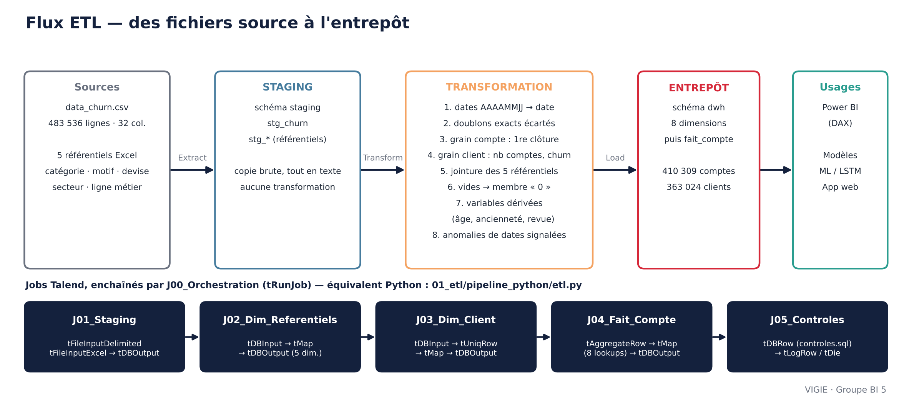

# 01 — Compréhension des données et ETL

| Contenu | Fichier | Statut |
|---|---|---|
| Analyse univariée, manquants, outliers | [`notebooks/01_analyse_univariee.ipynb`](notebooks/01_analyse_univariee.ipynb) | obligatoire |
| Tableau de synthèse par variable | [`synthese_variables.md`](synthese_variables.md) | obligatoire |
| Analyse bivariée | [`notebooks/02_analyse_bivariee.ipynb`](notebooks/02_analyse_bivariee.ipynb) | bonus |
| Jobs Talend : spécification et exports | [`talend/`](talend/README.md) | obligatoire |
| Schéma du flux | [`schema_flux.png`](schema_flux.png) | obligatoire |
| Pipeline Python équivalent | [`pipeline_python/etl.py`](pipeline_python/etl.py) | bonus |
| Collecte de contexte sectoriel | [`scraping/`](scraping/README.md) | bonus |

## Le flux, de bout en bout



## Ce que la phase 1 a établi

| Constat | Chiffre | Conséquence |
|---|---|---|
| Volumes conformes au document des tuteurs | 483 536 lignes · 363 024 clients · 410 309 comptes | fichier intègre |
| Trois grains dans un seul fichier | ligne, compte, client | grain **compte** pour l'entrepôt, **client** pour le modèle |
| Le taux de churn dépend du grain | 40,3 % / 36,1 % / 32,3 % | toujours préciser le grain d'un taux |
| Aucun client à statut mixte | 0 client actif *et* clos | churn client sans ambiguïté |
| Vides liés à la clôture | solde vide pour 67,8 % des comptes clos, 0 % des actifs | **fuite de cible** à neutraliser |
| Soldes hors bornes IQR | 32,1 % | comptes débiteurs : interprétés, pas supprimés |
| Dates incohérentes | 20 166 comptes clos « avant » leur ouverture | signalés dans l'entrepôt |

## Règles de transformation (communes à Talend et à Python)

| # | Règle | Détail |
|---|---|---|
| R1 | Typage | dates `YYYYMMDD` → `date` ; montants → `numeric` ; vides conservés (`NULL`) |
| R2 | Doublons exacts | 8 335 lignes strictement identiques, absorbées par le passage au grain compte |
| R3 | Grain compte | une ligne par `ACCOUNT_NO` ; **première** date de clôture ; `nb_lignes_source` = lignes fusionnées |
| R4 | Grain client | une ligne par `CUSTOMER_NO` ; `nb_comptes` ; `est_churn` = tous les comptes sont clos |
| R5 | Référentiels | jointure des 5 fichiers Excel ; code absent → membre « Non renseigné » (clé 0) |
| R6 | Recodages | `COMPLETED_FILE` → booléen ; statut marital → libellé ; vides → « Non renseigné » |
| R7 | Variables dérivées | âge, tranche d'âge, ancienneté, tranche d'ancienneté, mois depuis la revue, revue en retard |
| R8 | Anomalies | ouverture postérieure à la clôture → drapeau, ancienneté non calculée |

## Exécuter les notebooks

```bash
pip install -r requirements.txt
# placer les fichiers fournis par les tuteurs dans data/ (ignoré par git)
jupyter lab 01_etl/notebooks/
```

Les notebooks n'affichent **aucune ligne client** : uniquement des comptages et des distributions.
