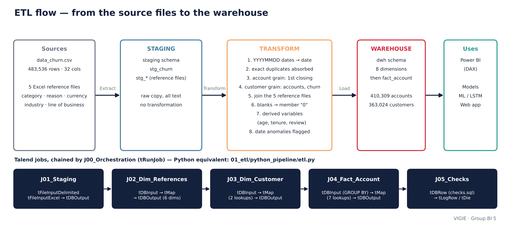

# 01 — Data understanding and ETL

| Content | File | Status |
|---|---|---|
| Univariate analysis, missing values, outliers | [`notebooks/01_univariate_analysis.ipynb`](notebooks/01_univariate_analysis.ipynb) | mandatory |
| Summary table per variable | [`variable_summary.md`](variable_summary.md) | mandatory |
| Bivariate analysis | [`notebooks/02_bivariate_analysis.ipynb`](notebooks/02_bivariate_analysis.ipynb) | bonus |
| Talend jobs: specification and exports | [`talend/`](talend/README.md) | mandatory |
| Flow diagram | [`etl_flow.png`](etl_flow.png) | mandatory |
| Equivalent Python pipeline | [`python_pipeline/etl.py`](python_pipeline/etl.py) | bonus |

## The flow, end to end



## What phase 1 established

| Finding | Figure | Consequence |
|---|---|---|
| Volumes match the supervisors' document | 483,536 rows · 363,024 customers · 410,309 accounts | the file is intact |
| Three grains in a single file | row, account, customer | **account** grain for the warehouse, **customer** grain for the model |
| The churn rate depends on the grain | 40.3% / 36.1% / 32.3% | always state the grain of a rate |
| No customer with a mixed status | 0 customer both active *and* closed | customer churn is unambiguous |
| Blanks tied to the closure | balance blank for 67.8% of closed accounts, 0% of active ones | **target leak** to neutralise |
| Balances outside the IQR bounds | 32.1% | accounts in debit: interpreted, not removed |
| Inconsistent dates | 20,166 accounts closed "before" they were opened | flagged in the warehouse |

## Transformation rules (shared by Talend and Python)

| # | Rule | Detail |
|---|---|---|
| R1 | Typing | `YYYYMMDD` dates → `date`; amounts → `numeric`; blanks kept (`NULL`) |
| R2 | Exact duplicates | 8,335 strictly identical rows, absorbed by the move to account grain |
| R3 | Account grain | one row per `ACCOUNT_NO`; **first** closing date; `n_source_rows` = merged rows |
| R4 | Customer grain | one row per `CUSTOMER_NO`; `n_accounts`; `is_churned` = all accounts are closed |
| R5 | Reference files | join of the 5 Excel files; missing code → "Not provided" member (key 0) |
| R6 | Recoding | `COMPLETED_FILE` → boolean; marital status → label; blanks → "Not provided" |
| R7 | Derived variables | age, age band, tenure, tenure band, months since review, review overdue |
| R8 | Anomalies | opening later than closing → flag, age not computed |

## Running the notebooks

```bash
pip install -r requirements.txt
```

```bash
jupyter lab 01_etl/notebooks/
```

Put the files provided by the supervisors in `data/` first (git-ignored). The notebooks display **no customer
row**: only counts and distributions.
