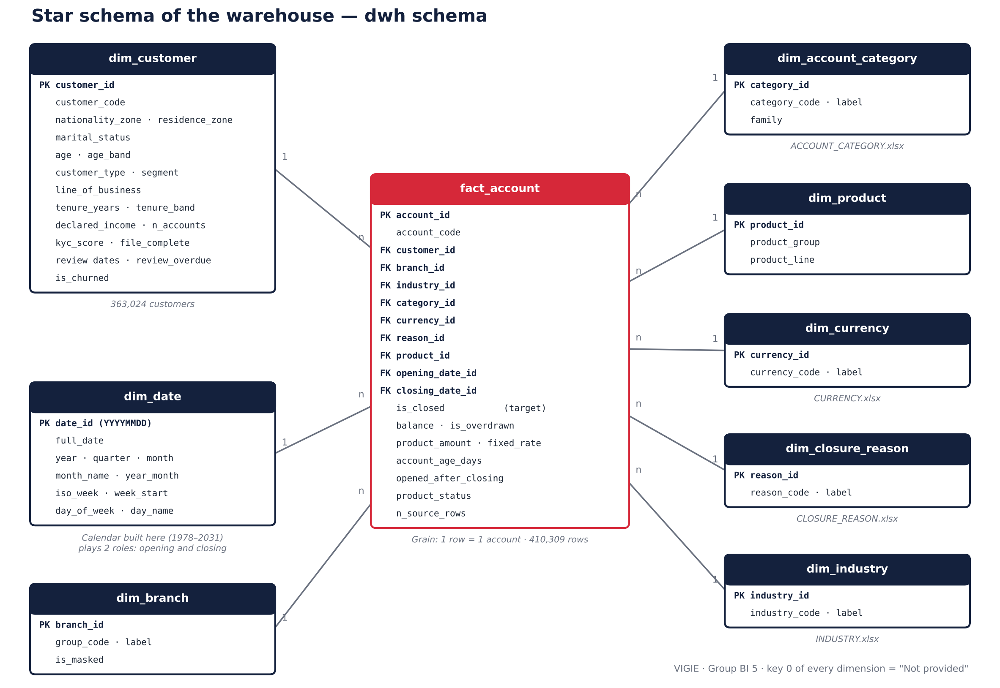
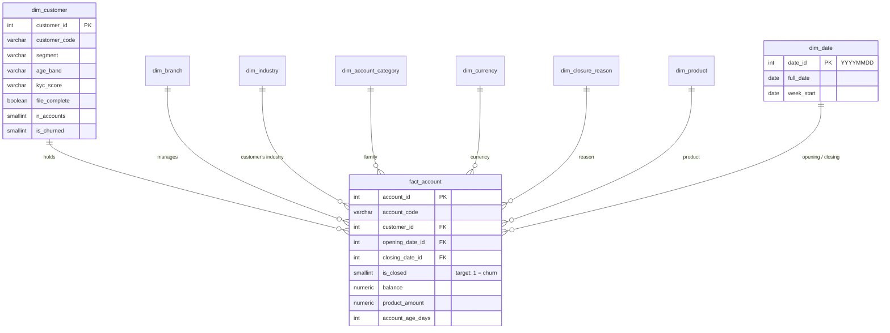

# 02 — Data Warehouse

**PostgreSQL** warehouse of the VIGIE project (Group BI 5), modelled as a **star schema** and administered with **pgAdmin**.

| File | Role |
|---|---|
| [`schema/create_tables.sql`](schema/create_tables.sql) | Creates the `staging` and `dwh` schemas, the 8 dimensions, the fact table, the calendar and the views |
| [`schema/star_schema.png`](schema/star_schema.png) | Star schema diagram |
| [`checks/checks.sql`](checks/checks.sql) | 19 source ↔ warehouse checks, each with an OK / KO verdict |
| [`checks/check_results.md`](checks/check_results.md) | Result of the last run (19 / 19 OK), written by `checks/check_report.py` |
| [`kpis.md`](kpis.md) | Catalogue of the 20 KPIs: grain, formula, reference value |
| [`scd2/dim_customer_scd2.sql`](scd2/dim_customer_scd2.sql) | *Bonus* — type 2 slowly changing customer dimension |

## The star schema

## Design choices, and why

### 1. The grain: one account

The source file mixes three grains (row, account, customer). **One row of `fact_account` = one account.**

* It is the grain of the **target**: churn is defined by the closure of an *account*.
* It is the finest grain that is **stable**: every attribute of an account is constant from one row of the file
  to the next, except the closing date.
* It can be **re-aggregated** safely to the customer, the branch or the week. The reverse would be impossible.

When an account carries several closing dates (11,807 accounts), **the first one** is kept: it is the churn event.
The number of merged rows is kept in `n_source_rows` for reconciliation (check C04).

### 2. Customers with no account stay in the dimension

43,984 customers hold no account. They are loaded into `dim_customer` with `n_accounts = 0` and
`is_churned = NULL`, but generate no fact. *All* customers can thus be counted (K04) without distorting churn rates.

### 3. The "Not provided" member (key 0)

Every dimension holds a row with key `0`. A blank value in the source points to it: **no foreign key is null**, no
join loses rows, and Power BI shows "Not provided" rather than a blank. This matters here, because a quarter of the
accounts have no family, no currency and no opening date.

### 4. A calendar built here, playing two roles

`dim_date` is generated with `generate_series` (1978 → 2031). It is linked twice to the fact table: opening date
and closing date (*role-playing dimension*). The `week_start` column gives the weekly grain of the time series directly.

### 5. Derived variables are computed once

Age, age band, tenure, months since last review, review overdue: these variables are computed by the ETL and stored
in `dim_customer`. Power BI, the models and the application therefore read **the same value**.
The reference date is the last account event observed (19 Feb 2024 in the shifted dataset).

### 6. Anomalies are flagged, not hidden

20,166 closed accounts have an opening date later than their closing date. The warehouse keeps the source value,
raises the `opened_after_closing` flag and does not compute the age of these accounts (checks C15 and C19).

## Setting up with pgAdmin

1. In pgAdmin: right-click *Databases* → *Create* → *Database…* → name **`vigie_dwh`**, encoding `UTF8`.
2. Open the *Query Tool* on `vigie_dwh`, load `schema/create_tables.sql`, run it (F5).
   The script creates the schemas, the tables, the calendar and the views. It can be re-run.
3. Load the warehouse with the **Talend** jobs (see [`01_etl/talend/`](../01_etl/talend/README.md)) or, for
   comparison, with the Python pipeline: `python 01_etl/python_pipeline/etl.py`.
4. Load `checks/checks.sql` and run it: the 19 rows must show **OK**.

## Ready-made views

| View | Content | Used by |
|---|---|---|
| `dwh.v_kpi_overall` | Volume and churn KPIs, in one row | Power BI overview page, checks |
| `dwh.v_weekly_closures` | Closures per week, zero weeks included | time series (phase 4) |
| `dwh.v_churn_by_customer_segment` | Churn rate by segment, age, tenure, KYC, file | segmentation |
| `dwh.v_checks` | The 19 checks and their values | acceptance of the load |

## Bonus — SCD type 2

`scd2/dim_customer_scd2.sql` keeps the history of the customer attributes that are likely to change (KYC score,
segment, complete file): each change closes the current version and opens a new one (`valid_from`, `valid_to`,
`is_current`). The script includes a demonstration on four **fictitious** customers and an "as of a given date"
query. Since the provided dataset is a single snapshot, there is no real history to load: the mechanism is ready
for a second load.
