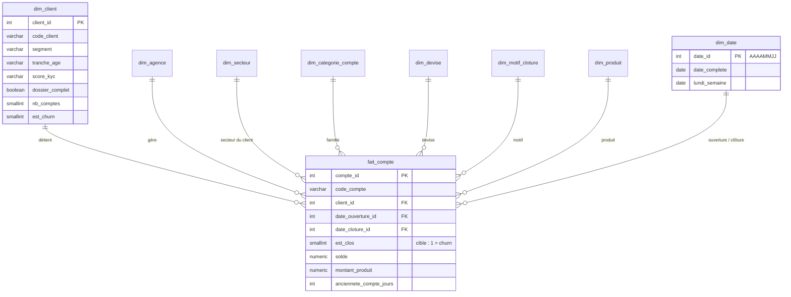

# 02 — Data Warehouse

Entrepôt **PostgreSQL** du projet VIGIE (Groupe BI 5), modélisé **en étoile** et administré avec **pgAdmin**.

| Fichier | Rôle |
|---|---|
| [`schema/create_tables.sql`](schema/create_tables.sql) | Création des schémas `staging` et `dwh`, des 8 dimensions, de la table de faits, du calendrier et des vues |
| [`schema/star_schema.png`](schema/star_schema.png) | Diagramme du modèle en étoile |
| [`controles/controles.sql`](controles/controles.sql) | 19 contrôles source ↔ entrepôt, avec verdict OK / KO |
| [`controles/resultats_controles.md`](controles/resultats_controles.md) | Résultat de la dernière exécution (19 / 19 OK) |
| [`kpis.md`](kpis.md) | Catalogue des 20 KPI : grain, formule, valeur de référence |
| [`scd2/dim_client_scd2.sql`](scd2/dim_client_scd2.sql) | *Bonus* — historisation SCD de type 2 de la dimension client |

## Le modèle en étoile

## Les choix de conception, et pourquoi

### 1. Le grain : un compte

Le fichier source mélange trois grains (ligne, compte, client). **Une ligne de `fait_compte` = un compte.**

* C'est le grain de la **cible** : le churn est défini par la clôture d'un *compte*.
* C'est le grain le plus fin qui soit **stable** : tous les attributs d'un compte sont constants d'une ligne à
  l'autre du fichier, sauf la date de clôture.
* Il se **ré-agrège** sans risque vers le client, l'agence ou la semaine. L'inverse serait impossible.

Quand un compte porte plusieurs dates de clôture (11 807 comptes), on retient **la première** : c'est l'événement de
churn. Le nombre de lignes fusionnées est conservé dans `nb_lignes_source` pour le contrôle (C04).

### 2. Les clients sans compte restent dans la dimension

43 984 clients n'ont aucun compte. Ils sont chargés dans `dim_client` avec `nb_comptes = 0` et `est_churn = NULL`,
mais ne génèrent aucun fait. On peut ainsi compter *tous* les clients (K04) sans fausser les taux de churn.

### 3. Le membre « Non renseigné » (clé 0)

Chaque dimension contient une ligne de clé `0`. Une valeur vide dans la source pointe vers elle : **aucune clé
étrangère n'est nulle**, aucune jointure ne perd de lignes, et Power BI affiche « Non renseigné » plutôt qu'un vide.
C'est essentiel ici, car un quart des comptes n'a ni famille, ni devise, ni date d'ouverture.

### 4. Un calendrier construit, qui joue deux rôles

`dim_date` est générée par `generate_series` (1978 → 2031). Elle est reliée deux fois à la table de faits :
date d'ouverture et date de clôture (*role-playing dimension*). La colonne `lundi_semaine` donne directement le
grain hebdomadaire de la série temporelle.

### 5. Les variables dérivées sont calculées une seule fois

Âge, tranche d'âge, ancienneté, mois depuis la dernière revue, revue en retard : ces variables sont calculées par
l'ETL et stockées dans `dim_client`. Power BI, les modèles et l'application lisent ainsi **la même valeur**.
La date de référence est le dernier événement de compte observé (19/02/2024 dans le jeu décalé).

### 6. Les anomalies sont signalées, pas maquillées

20 166 comptes clos ont une date d'ouverture postérieure à leur date de clôture. L'entrepôt garde la valeur source,
lève le drapeau `ouverture_apres_cloture` et ne calcule pas l'ancienneté de ces comptes (contrôles C15 et C19).

## Mise en place avec pgAdmin

1. Dans pgAdmin : clic droit sur *Databases* → *Create* → *Database…* → nom **`vigie_dwh`**, encodage `UTF8`.
2. Ouvrir le *Query Tool* sur `vigie_dwh`, charger `schema/create_tables.sql`, exécuter (F5).
   Le script crée les schémas, les tables, le calendrier et les vues. Il est ré-exécutable.
3. Alimenter l'entrepôt avec les jobs **Talend** (voir [`01_etl/talend/`](../01_etl/talend/README.md)) ou, pour
   comparer, avec le pipeline Python : `python 01_etl/pipeline_python/etl.py`.
4. Charger `controles/controles.sql` et exécuter : les 19 lignes doivent afficher **OK**.

## Vues prêtes à l'emploi

| Vue | Contenu | Utilisée par |
|---|---|---|
| `dwh.v_kpi_global` | Les KPI de volume et de churn, en une ligne | page d'accueil Power BI, contrôles |
| `dwh.v_clotures_hebdo` | Clôtures par semaine, semaines à zéro incluses | série temporelle (phase 4) |
| `dwh.v_churn_segment_client` | Taux de churn par segment, âge, ancienneté, KYC, dossier | segmentation |
| `dwh.v_controles` | Les 19 contrôles et leurs valeurs | recette du chargement |

## Bonus — SCD de type 2

`scd2/dim_client_scd2.sql` historise les attributs du client susceptibles de changer (score KYC, segment, dossier
complet) : chaque changement ferme la version courante et en ouvre une nouvelle (`date_debut_validite`,
`date_fin_validite`, `est_version_courante`). Le script contient une démonstration sur quatre clients **fictifs**
et une requête « état à une date donnée ». Le jeu fourni étant une photographie unique, il n'y a pas d'historique
réel à charger : le mécanisme est prêt pour un second chargement.
