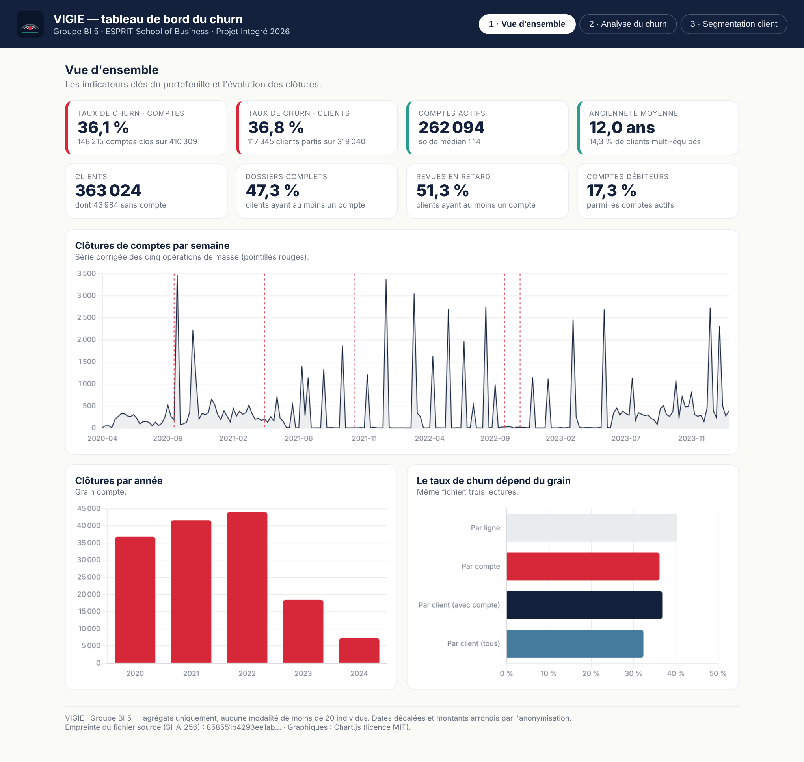
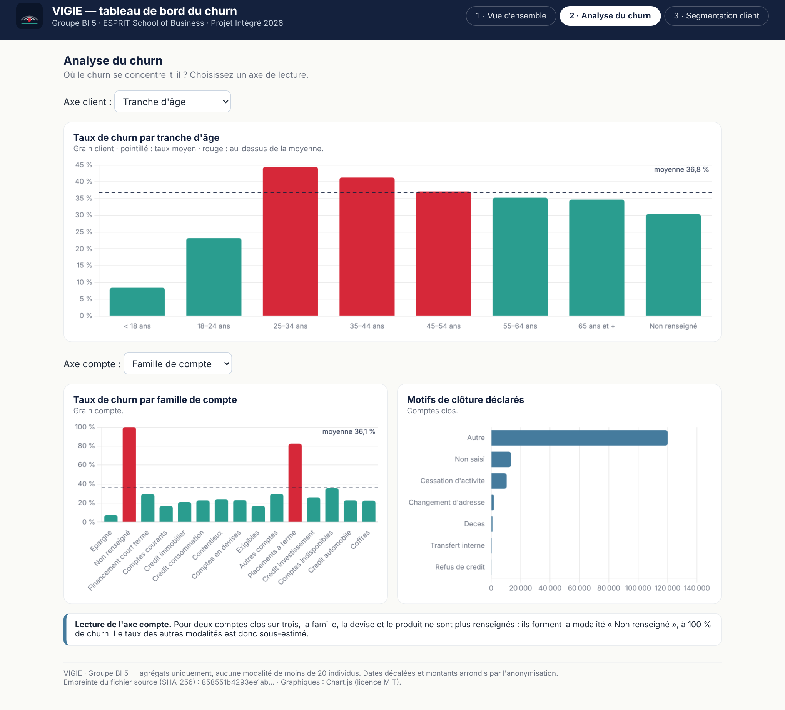
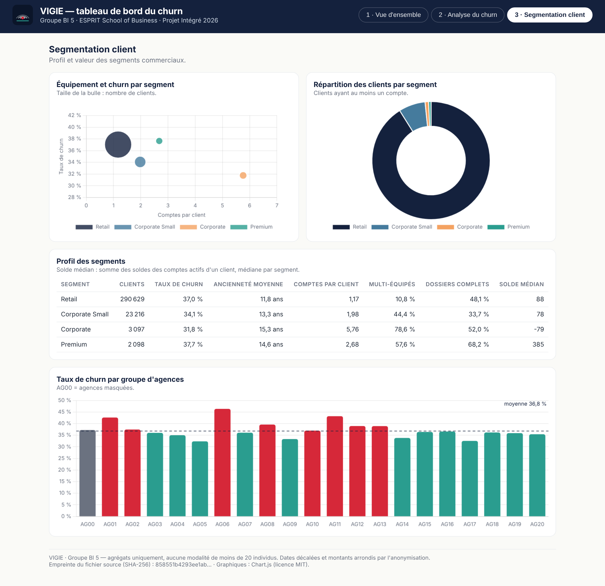

# 03 — Reporting Power BI

| Livrable | Fichier | Statut |
|---|---|---|
| Documentation des mesures DAX | [`measures_dax.md`](measures_dax.md) | 30 mesures, chacune avec sa valeur attendue |
| Guide de construction du rapport | [`guide_construction.md`](guide_construction.md) | connexion, modèle, 3 pages, interactivité |
| Thème du rapport | [`theme_vigie.json`](theme_vigie.json) | charte VIGIE (couleurs, polices) |
| Maquettes des trois pages | [`maquettes/`](maquettes/) | produites par l'interface JavaScript |
| Captures du rapport | [`screenshots/`](screenshots/README.md) | **à déposer** après construction du `.pbix` |
| *Bonus* — interface JavaScript | [`bonus_javascript/`](bonus_javascript/) | Chart.js, alimentée par des agrégats |
| Fichier `rapport.pbix` | — | **jamais dans le dépôt** : remis aux tuteurs hors GitHub |

## Les trois pages

| Page | Question | Visuels principaux |
|---|---|---|
| **1 · Vue d'ensemble** | Où en est le churn ? | 8 cartes KPI, clôtures par semaine et par année, effet du grain |
| **2 · Analyse du churn** | Où se concentre-t-il ? | churn par âge, ancienneté, conformité, produit, devise ; motifs ; arbre de décomposition |
| **3 · Segmentation client** | À quoi ressemblent les segments ? | carte équipement × churn, profil des segments, agences, croisement âge × ancienneté |

## Trois règles qui rendent les mesures justes

1. **Un taux à son grain.** `Taux Churn Comptes` (36,12 %) et `Taux Churn Clients` (36,78 %) sont deux mesures
   distinctes ; le taux « par ligne » du fichier source (40,3 %) n'existe plus dans l'entrepôt.
2. **Deux relations de date inactives.** `dim_date` sert à la fois à l'ouverture et à la clôture ; chaque mesure
   temporelle choisit son rôle avec `USERELATIONSHIP`. Un filtre de date ne fausse donc pas les KPI globaux.
3. **« Non renseigné » reste visible.** 68 % des comptes clos n'ont plus de famille, de devise ni de produit :
   masquer ce membre ferait croire que certaines familles ne « churnent » presque pas.

## Vérifier le rapport

Chaque mesure de `measures_dax.md` est accompagnée de la valeur calculée en SQL sur l'entrepôt. Le rapport est juste
quand, sans filtre, il affiche : 410 309 comptes · 148 215 clos · 36,12 % · 363 024 clients · 117 345 partis · 36,78 %.

## Bonus — interface JavaScript

[`bonus_javascript/index.html`](bonus_javascript/index.html) reprend les trois pages dans une page web autonome
(Chart.js). Elle s'ouvre par un double-clic, fonctionne hors connexion et ne contient que des agrégats
(`donnees.js`, généré par `python outils/exporter_tableau_js.py`). Elle sert aussi de maquette pour le rapport Power BI.

| Analyse du churn | Segmentation client |
|---|---|
|  |  |
