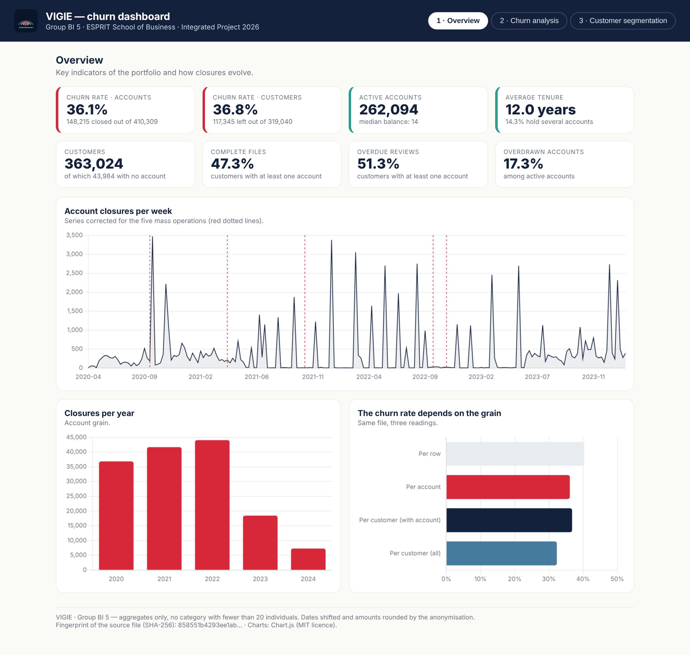
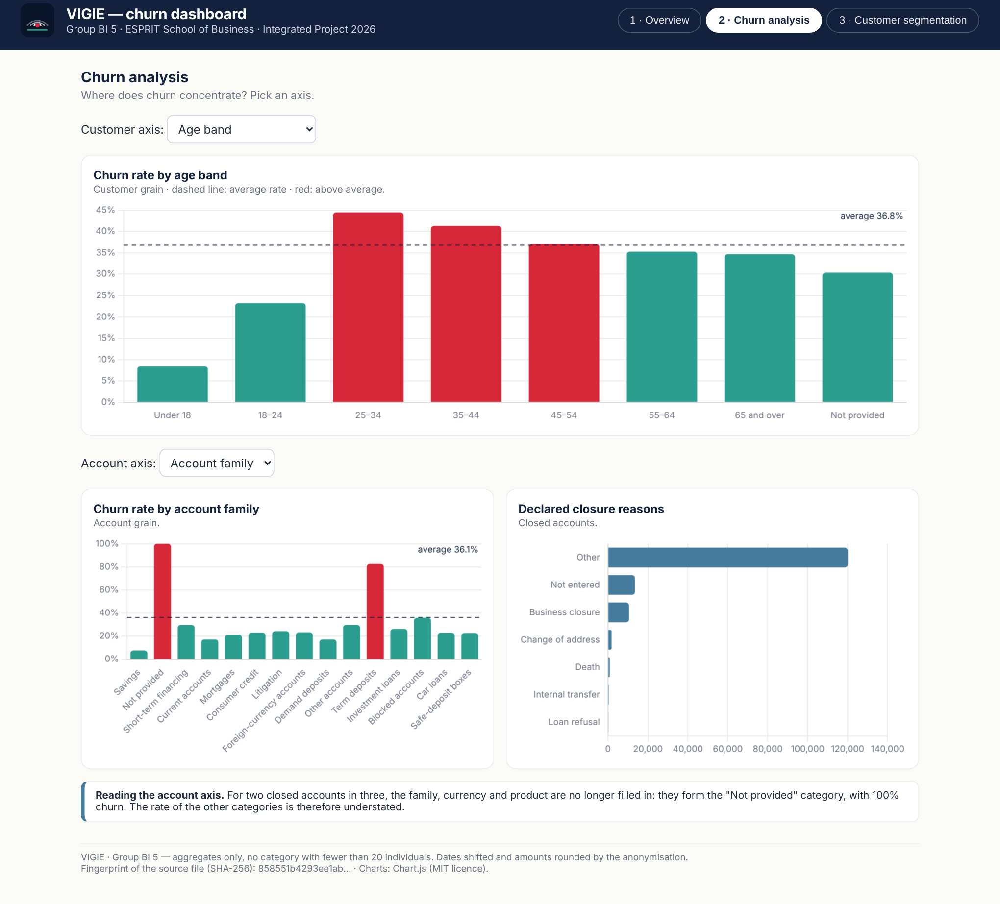
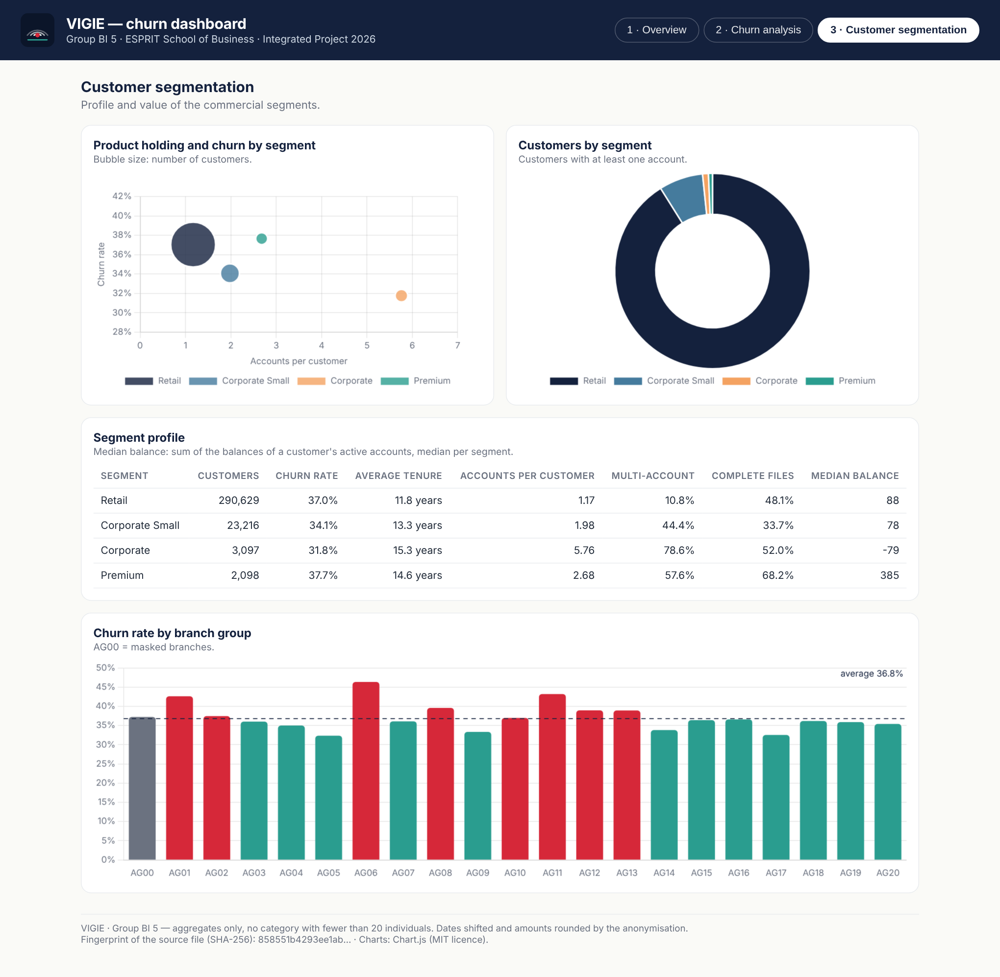

# Building the Power BI report — step by step

> This guide leads to the `report.pbix` file to hand to the supervisors **outside GitHub**. The mockups in
> [`mockups/`](mockups/) show the target result; the values to find are in [`dax_measures.md`](dax_measures.md).

## Step 1 — Connect to the warehouse

1. Power BI Desktop → **Get data → PostgreSQL database**.
2. Server `localhost:5432`, database `vigie_dwh`, **Import** mode.
3. Tick the 9 tables of the `dwh` schema: `fact_account`, `dim_customer`, `dim_date`, `dim_branch`, `dim_industry`,
   `dim_account_category`, `dim_currency`, `dim_closure_reason`, `dim_product`. Do not import the `staging` schema.
4. In Power Query: check the types (dates as *Date*, `is_closed` as *Whole number*, booleans as *True/False*), then
   **Close & Apply**.

> If the PostgreSQL connector is missing, install the **Npgsql** driver (version 4.0.x, *GAC Installation* option).

## Step 2 — Set up the model

1. **Model** view: check the 7 active relationships and create the 2 date relationships, then make them **inactive**
   (double-click the relationship → untick *Make this relationship active*). The full table is in `dax_measures.md`.
2. `dim_date` → **Mark as date table** (`full_date` column).
3. Hide every `*_id` column, plus `customer_code` and `account_code`.
4. Sort `month_name` by `month`; sort `age_band` and `tenure_band` with an order column:

   ```dax
   Age Band Order =
   SWITCH ( dim_customer[age_band],
       "Under 18", 1, "18–24", 2, "25–34", 3, "35–44", 4,
       "45–54", 5, "55–64", 6, "65 and over", 7, 8 )

   Tenure Band Order =
   SWITCH ( dim_customer[tenure_band],
       "Under 2 years", 1, "2–5 years", 2, "5–10 years", 3, "10–15 years", 4, "15 years and over", 5, 6 )
   ```

5. Create the `_Measures` table (**Enter data**, one empty column) and type in the measures of `dax_measures.md`.
6. **View → Themes → Browse for themes** → `vigie_theme.json`: colours and fonts of the VIGIE identity.

## Step 3 — Check before drawing

Place six temporary cards (`Accounts`, `Closed Accounts`, `Customers`, `Churned Customers`, `Account Churn Rate`,
`Customer Churn Rate`): they must show 410,309 · 148,215 · 363,024 · 117,345 · 36.12% · 36.78%.
**Do not go further until they do.**

## Step 4 — Page 1: Overview



| Zone | Visual | Fields |
|---|---|---|
| Banner | Text box + logo | dynamic title `Overview Title` |
| KPI row | 8 cards | `Account Churn Rate`, `Customer Churn Rate`, `Active Accounts`, `Average Customer Tenure`, `Customers`, `Complete File Share`, `Overdue Review Share`, `Overdrawn Share` |
| Trend | Line chart | axis `dim_date[week_start]` · values `Closures` and `Closures 8-Week Moving Average` |
| Per year | Column chart | axis `dim_date[year]` · value `Closures` (year → quarter → month hierarchy for **drill-down**) |
| Grain | Bar chart | `Account Churn Rate`, `Customer Churn Rate`, `All Customers Churn Rate` |
| Filters | Slicers | `dim_customer[segment]`, `dim_branch[group_code]` |

On the trend chart, add a **card** `Share of the 5 Mass Weeks` (51.0%) and a text box:
"Five weeks carry half of the closures: they are mass operations."

## Step 5 — Page 2: Churn analysis



| Zone | Visual | Fields |
|---|---|---|
| By age | Column chart | axis `dim_customer[age_band]` · value `Customer Churn Rate` · colour `Churn Colour` · constant line = average |
| By tenure | Column chart | axis `dim_customer[tenure_band]` · value `Customer Churn Rate` |
| By compliance | Clustered column chart | axis `dim_customer[kyc_score]` · legend `dim_customer[file_complete]` · value `Customer Churn Rate` |
| By product | Bar chart | axis `dim_account_category[label]` · value `Account Churn Rate` · tooltip `Accounts` |
| By currency | Column chart | axis `dim_currency[label]` · value `Account Churn Rate` |
| Reasons | Bar chart | axis `dim_closure_reason[label]` · value `Closed Accounts` |
| Decomposition tree | Decomposition tree | analyse `Customer Churn Rate` · explain by `segment`, `age_band`, `tenure_band`, `kyc_score`, `file_complete`, `review_overdue` |
| Filters | Slicers | `dim_customer[customer_type]`, `dim_customer[residence_zone]` |

Two reading precautions, to write on the page:

* visuals by **family, currency and product** keep the "Not provided" member visible (card `Not Provided Warning`);
* the rate is read **per account** on account axes and **per customer** on customer axes.

The labels of account families, currencies and reasons come from the reference files (source data, partly in
French); the English wording used in the mockups is listed in `vigie/data.py` (`ENGLISH_LABELS`). A Power Query
replace step or a small mapping table can apply it in the report.

## Step 6 — Page 3: Customer segmentation



| Zone | Visual | Fields |
|---|---|---|
| Segment map | Scatter chart | X `Accounts per Customer` · Y `Customer Churn Rate` · size `Customers With Account` · legend `dim_customer[segment]` |
| Split | Doughnut | legend `dim_customer[segment]` · value `Customers With Account` |
| Profile | Matrix | rows `dim_customer[segment]` · values `Customers With Account`, `Customer Churn Rate`, `Risk Index`, `Average Customer Tenure`, `Accounts per Customer`, `Multi-Account Share`, `Complete File Share`, `Median Balance per Customer` |
| Branches | Column chart | axis `dim_branch[group_code]` · value `Customer Churn Rate` · colour `Churn Colour` |
| Cross-analysis | Matrix (heat map) | rows `age_band` · columns `tenure_band` · value `Customer Churn Rate` · gradient conditional formatting |

## Step 7 — Interactivity

* **Navigation**: three buttons in the banner (*Insert → Buttons → Page navigator*).
* **Synced slicers**: *View → Sync slicers* to keep the commercial segment from one page to another.
* **Drill-down**: `year → quarter → month_name` hierarchy on the time charts; `family → label` on `dim_account_category`.
* **Report tooltip**: a hidden page of "Tooltip" size showing `Customers With Account`, `Customer Churn Rate` and
  `Risk Index`, attached to the column charts of page 2.
* **Drill-through**: from a segment to page 3 filtered on that segment.

## Step 8 — Before handing in

- [ ] The values match `dax_measures.md` (sections 2 to 6).
- [ ] No table or visual shows a customer row or an identifier.
- [ ] The three screenshots are in `screenshots/`, with no customer row.
- [ ] The `.pbix` is **not** in the repository (`*.pbix` is in `.gitignore`) and is not published to the web.
