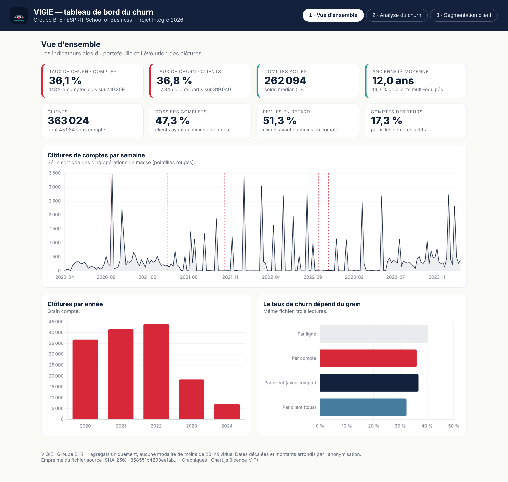
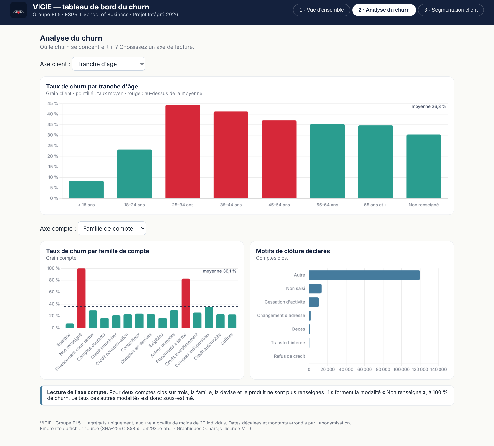
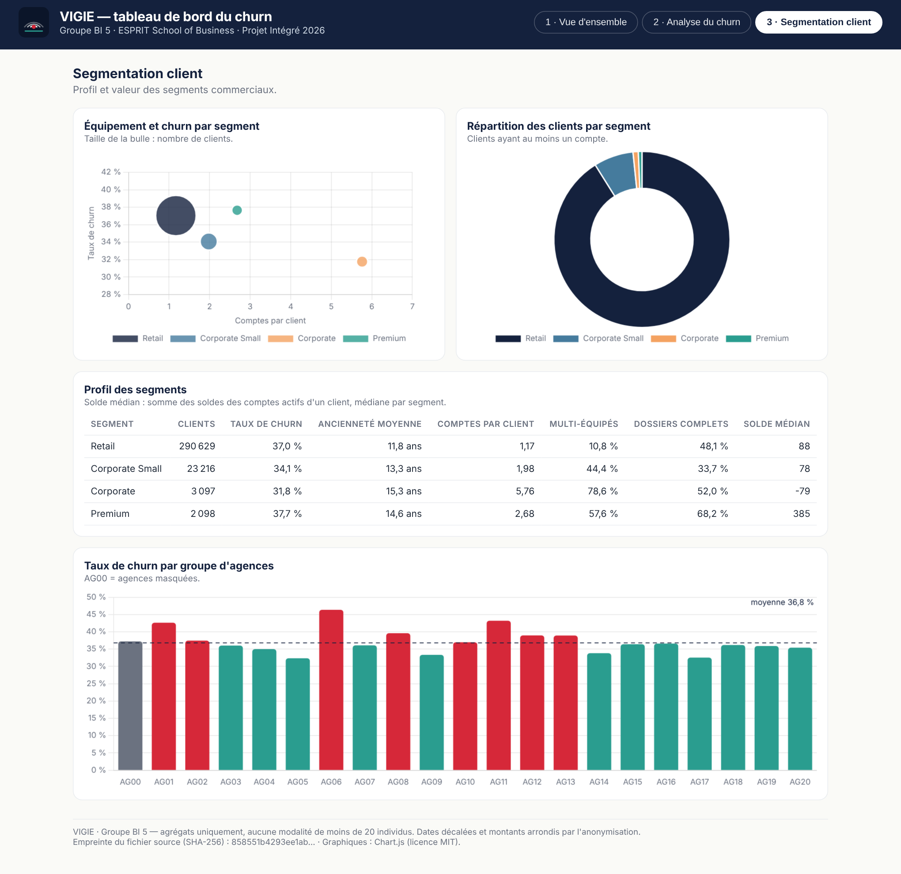

# Construire le rapport Power BI — pas à pas

> Ce guide mène au fichier `rapport.pbix` à remettre aux tuteurs **hors GitHub**. Les maquettes de
> [`maquettes/`](maquettes/) montrent le résultat visé ; les valeurs à retrouver sont dans
> [`measures_dax.md`](measures_dax.md).

## Étape 1 — Se connecter à l'entrepôt

1. Power BI Desktop → **Obtenir les données → Base de données PostgreSQL**.
2. Serveur `localhost:5432`, base `vigie_dwh`, mode **Importer**.
3. Cocher les 9 tables du schéma `dwh` : `fait_compte`, `dim_client`, `dim_date`, `dim_agence`, `dim_secteur`,
   `dim_categorie_compte`, `dim_devise`, `dim_motif_cloture`, `dim_produit`. Ne pas importer le schéma `staging`.
4. Dans Power Query : vérifier les types (dates en *Date*, `est_clos` en *Nombre entier*, booléens en *Vrai/Faux*),
   puis **Fermer et appliquer**.

> Si le connecteur PostgreSQL manque, installer le pilote **Npgsql** (version 4.0.x, option *GAC Installation*).

## Étape 2 — Régler le modèle

1. Vue **Modèle** : vérifier les 7 relations actives et créer les 2 relations de date, puis les rendre **inactives**
   (double-clic sur la relation → décocher *Activer cette relation*). Le tableau complet est dans `measures_dax.md`.
2. `dim_date` → **Marquer comme table de dates** (colonne `date_complete`).
3. Masquer toutes les colonnes `*_id`, `code_client` et `code_compte`.
4. Trier `nom_mois` par `mois` ; trier `tranche_age` et `tranche_anciennete` avec une colonne d'ordre :

   ```dax
   Ordre Tranche Âge =
   SWITCH ( dim_client[tranche_age],
       "< 18 ans", 1, "18–24 ans", 2, "25–34 ans", 3, "35–44 ans", 4,
       "45–54 ans", 5, "55–64 ans", 6, "65 ans et +", 7, 8 )

   Ordre Tranche Ancienneté =
   SWITCH ( dim_client[tranche_anciennete],
       "< 2 ans", 1, "2–5 ans", 2, "5–10 ans", 3, "10–15 ans", 4, "15 ans et +", 5, 6 )
   ```

5. Créer la table `_Mesures` (**Entrer des données**, une colonne vide) et y saisir les mesures de `measures_dax.md`.
6. **Affichage → Thèmes → Rechercher des thèmes** → `theme_vigie.json` : couleurs et polices de la charte VIGIE.

## Étape 3 — Vérifier avant de dessiner

Poser six cartes provisoires (`Nb Comptes`, `Nb Comptes Clos`, `Nb Clients`, `Nb Clients Partis`,
`Taux Churn Comptes`, `Taux Churn Clients`) : elles doivent afficher 410 309 · 148 215 · 363 024 · 117 345 ·
36,12 % · 36,78 %. **Ne pas aller plus loin tant que ce n'est pas le cas.**

## Étape 4 — Page 1 : Vue d'ensemble



| Zone | Visuel | Champs |
|---|---|---|
| Bandeau | Zone de texte + logo | titre dynamique `Titre Vue d'ensemble` |
| Ligne de KPI | 8 cartes | `Taux Churn Comptes`, `Taux Churn Clients`, `Nb Comptes Actifs`, `Ancienneté Moyenne Clients`, `Nb Clients`, `Part Dossiers Complets`, `Part Revues en Retard`, `Part Comptes Débiteurs` |
| Évolution | Graphique en courbes | axe `dim_date[lundi_semaine]` · valeurs `Clôtures` et `Clôtures Moyenne Mobile 8 sem` |
| Par année | Histogramme | axe `dim_date[annee]` · valeur `Clôtures` (hiérarchie année → trimestre → mois pour le **drill-down**) |
| Grain | Histogramme horizontal | `Taux Churn Comptes`, `Taux Churn Clients`, `Taux Churn Tous Clients` |
| Filtres | Segments | `dim_client[segment]`, `dim_agence[code_groupe]` |

Sur le graphique d'évolution, ajouter une **carte** `Part des 5 Semaines de Masse` (51,0 %) et une zone de texte :
« Cinq semaines portent la moitié des clôtures : ce sont des opérations de masse. »

## Étape 5 — Page 2 : Analyse du churn



| Zone | Visuel | Champs |
|---|---|---|
| Par âge | Histogramme | axe `dim_client[tranche_age]` · valeur `Taux Churn Clients` · couleur `Couleur Churn` · ligne constante = moyenne |
| Par ancienneté | Histogramme | axe `dim_client[tranche_anciennete]` · valeur `Taux Churn Clients` |
| Par conformité | Histogramme groupé | axe `dim_client[score_kyc]` · légende `dim_client[dossier_complet]` · valeur `Taux Churn Clients` |
| Par produit | Histogramme horizontal | axe `dim_categorie_compte[libelle]` · valeur `Taux Churn Comptes` · infobulle `Nb Comptes` |
| Par devise | Histogramme | axe `dim_devise[libelle]` · valeur `Taux Churn Comptes` |
| Motifs | Graphique en barres | axe `dim_motif_cloture[libelle]` · valeur `Nb Comptes Clos` |
| Arbre de décomposition | Decomposition tree | analyser `Taux Churn Clients` · expliquer par `segment`, `tranche_age`, `tranche_anciennete`, `score_kyc`, `dossier_complet`, `revue_en_retard` |
| Filtres | Segments | `dim_client[nature_client]`, `dim_client[zone_residence]` |

Deux précautions de lecture, à écrire sur la page :

* les visuels par **famille, devise et produit** gardent visible le membre « Non renseigné » (carte
  `Avertissement Non Renseigné`) ;
* le taux se lit **par compte** sur les axes du compte et **par client** sur les axes du client.

## Étape 6 — Page 3 : Segmentation client



| Zone | Visuel | Champs |
|---|---|---|
| Carte des segments | Nuage de points | X `Comptes par Client` · Y `Taux Churn Clients` · taille `Nb Clients Avec Compte` · légende `dim_client[segment]` |
| Répartition | Anneau | légende `dim_client[segment]` · valeur `Nb Clients Avec Compte` |
| Profil | Matrice | lignes `dim_client[segment]` · valeurs `Nb Clients Avec Compte`, `Taux Churn Clients`, `Indice de Risque`, `Ancienneté Moyenne Clients`, `Comptes par Client`, `Part Clients Multi-Équipés`, `Part Dossiers Complets`, `Solde Médian par Client` |
| Agences | Histogramme | axe `dim_agence[code_groupe]` · valeur `Taux Churn Clients` · couleur `Couleur Churn` |
| Croisement | Matrice (carte de chaleur) | lignes `tranche_age` · colonnes `tranche_anciennete` · valeur `Taux Churn Clients` · mise en forme conditionnelle en dégradé |

## Étape 7 — Interactivité

* **Navigation** : trois boutons dans le bandeau (*Insérer → Boutons → Navigateur de pages*).
* **Filtres synchronisés** : *Affichage → Synchroniser les segments* pour garder le segment commercial d'une page à l'autre.
* **Drill-down** : hiérarchie `annee → trimestre → nom_mois` sur les graphiques temporels ; `famille → libelle` sur
  `dim_categorie_compte`.
* **Infobulle de rapport** : une page masquée de taille « Info-bulle » affichant `Nb Clients Avec Compte`,
  `Taux Churn Clients` et `Indice de Risque`, rattachée aux histogrammes de la page 2.
* **Extraction** (*drill-through*) : depuis un segment vers la page 3 filtrée sur ce segment.

## Étape 8 — Avant de rendre

- [ ] Les valeurs correspondent à `measures_dax.md` (sections 2 à 6).
- [ ] Aucune table ni aucun visuel n'affiche de ligne client ou d'identifiant.
- [ ] Les trois captures sont déposées dans `screenshots/`, sans ligne client.
- [ ] Le `.pbix` n'est **pas** dans le dépôt (`*.pbix` est dans `.gitignore`) et n'est pas publié sur le Web.
