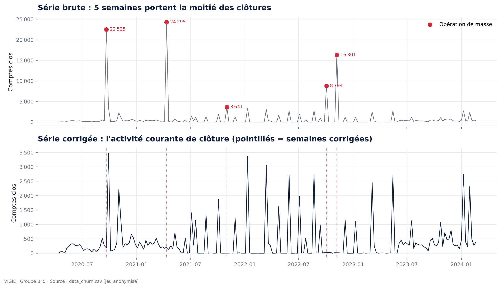
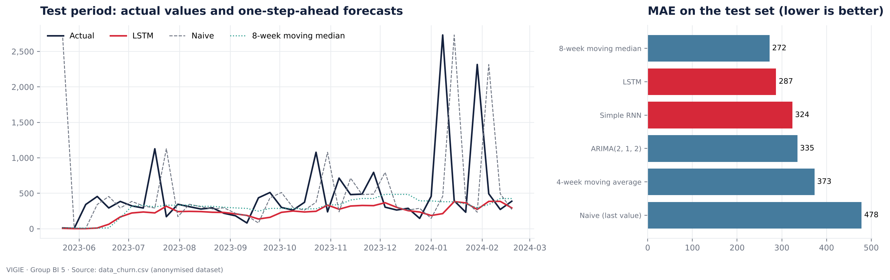
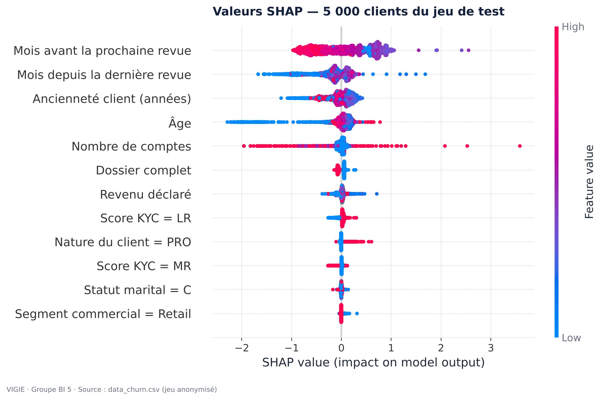

# 04 — Modèles prédictifs

Deux modèles, deux questions :

| Question | Modèle | Résultat principal |
|---|---|---|
| **Combien de comptes vont se fermer la semaine prochaine ?** | LSTM (Keras) sur la série hebdomadaire des clôtures | MAE 287 clôtures, soit **−40 %** par rapport à la prévision naïve |
| **Ce client risque-t-il de partir ?** | XGBoost sur 12 variables du profil client | **ROC-AUC 0,751 · PR-AUC 0,611** · recall 79 % |

Tous les tableaux comparatifs sont dans [`comparison.md`](comparison.md).

## Contenu

| Fichier | Rôle |
|---|---|
| [`notebooks/01_kpi_serie_temporelle.ipynb`](notebooks/01_kpi_serie_temporelle.ipynb) | Choix du KPI, construction de la série, pics, régimes, saisonnalité, ACF / PACF, stationnarité |
| [`notebooks/02_lstm_rnn.ipynb`](notebooks/02_lstm_rnn.ipynb) | LSTM et RNN contre 4 références, analyse des erreurs, prévision à 8 semaines, second KPI (bonus) |
| [`notebooks/03_churn_ml.ipynb`](notebooks/03_churn_ml.ipynb) | Contrôle de la fuite de cible, 3 modèles, optimisation, sensibilité, calibration, SHAP |
| [`src/prevision.py`](src/prevision.py) | Découpage chronologique, références, réseaux récurrents |
| [`src/churn.py`](src/churn.py) | Découpage par client, modèles, métriques, audit de fuite |
| [`src/export_app.py`](src/export_app.py) | Export des agrégats et des paramètres du modèle pour l'application |
| [`src/train.py`](src/train.py) | Ré-entraîne tout en une commande et vérifie les résultats publiés |
| [`src/rapport_comparatif.py`](src/rapport_comparatif.py) | Génère `comparison.md` à partir des résultats |
| [`resultats/`](resultats/) | Métriques et séries agrégées (JSON) écrites par les notebooks |
| `models/` | Modèles sauvegardés — **dossier hors dépôt** (`.gitignore`) |

## 1. Le KPI et sa série temporelle

**KPI retenu : le nombre hebdomadaire de clôtures de comptes.** C'est la mesure directe du churn, elle est
actionnable (dimensionner les équipes de rétention) et elle est disponible à la semaine (202 points, contre 47 au mois).

| Constat de l'analyse | Décision |
|---|---|
| 5 semaines sur 202 portent **51 %** des clôtures : des opérations de masse | Série **corrigée** (médiane locale) ; l'indicateur de masse est conservé pour l'affichage |
| 11 semaines sans aucune clôture | Ajoutées à zéro ; MAPE écarté (non défini) |
| Trois **régimes** : flux continu → traitement par lots → flux continu | Découpage chronologique strict, pas de composante saisonnière |
| PACF utile jusqu'à 5 semaines | Fenêtre glissante de **8 semaines** |
| Non stationnaire en logarithme, stationnaire après différenciation | ARIMA de référence avec `d = 1` |



## 2. LSTM contre références simples

Évaluation sur les **40 dernières semaines**, prévision à un pas, normalisation calculée sur l'entraînement seul.

| Modèle | MAE | RMSE | MAE vs naïve |
|---|---:|---:|---:|
| Médiane mobile 8 semaines | 272,4 | 549,8 | −43 % |
| **LSTM** (moyenne de 3 graines) | **287,2** | **577,2** | **−40 %** |
| RNN simple | 323,6 | 607,7 | −32 % |
| ARIMA(2, 1, 2) | 334,7 | 576,7 | −30 % |
| Moyenne mobile 4 semaines | 373,0 | 575,3 | −22 % |
| Naïve (dernière valeur) | 478,3 | 859,5 | — |

**Conclusion honnête.** Le LSTM prouve son intérêt face à la prévision naïve, au RNN simple et à ARIMA, mais il ne
bat pas une médiane mobile. Avec 134 fenêtres d'entraînement, un changement de régime entre entraînement et test et
des pics imprévisibles, c'est le résultat attendu — et le guide du projet le dit acceptable *s'il est démontré*.
Sur le second KPI (clients perdus par semaine), le LSTM obtient la meilleure MAE.



## 3. Contrôle de la fuite de cible

Le fichier est une photographie prise **après** les clôtures. Pour chaque colonne, nous mesurons l'AUC obtenue avec
le seul indicateur « la valeur est vide ».

* **10 colonnes exclues** (AUC du vide ≥ 0,80) : date et motif de clôture, solde, date d'ouverture, famille de
  compte, devise, montant, groupe et ligne de produits. `PRODUCT_STATUS` est exclue pour ses valeurs.
* **Preuve par l'exemple** : en ajoutant trois indicateurs de vide, la ROC-AUC passe de 0,751 à **0,951**.
  Un score proche de 100 % signale une fuite, pas un bon modèle.

## 4. Modèle de churn

* **Grain : le client** (319 040 clients ayant au moins un compte ; 36,8 % de partis). Aucun client n'a à la fois
  un compte actif et un compte clos.
* **12 variables** connues avant un départ : démographie (âge, statut marital, résidence), relation (ancienneté,
  nombre de comptes, nature, segment, revenu), conformité (score KYC, dossier complet, dernière et prochaine revue).
* **Découpage par client** (`GroupShuffleSplit`, 70 / 15 / 15) : aucun client commun entre deux jeux.
* **Pas de rééquilibrage** : le déséquilibre est modéré ; le compromis precision / recall se règle par le seuil.

| Modèle | ROC-AUC | PR-AUC | Precision | Recall | F1 |
|---|---:|---:|---:|---:|---:|
| Référence (taux moyen) | 0,500 | 0,369 | — | — | — |
| Régression logistique | 0,686 | 0,538 | 0,518 | 0,675 | 0,586 |
| Random Forest | 0,748 | 0,607 | 0,515 | 0,813 | 0,630 |
| **XGBoost optimisé (retenu)** | **0,751** | **0,611** | 0,526 | 0,790 | **0,632** |

**Pourquoi XGBoost ?** Le plus performant et le mieux calibré, il gère les valeurs manquantes nativement et
s'exporte en JSON lisible, sans aucune observation.

**Ce qui fait partir un client** (valeurs SHAP) : une revue de dossier en retard, puis l'âge (25–44 ans), une
ancienneté de 5 à 10 ans, un seul compte. La famille « conformité » porte 62 % de l'importance.



**Usage métier.** En contactant les 20 % de clients les mieux scorés, on touche 35 % des départs ; avec 30 %, la moitié.

## Reproduire

```bash
# données dans data/ (ignoré par git), puis :
python 04_machine_learning/src/train.py
```

Le script ré-entraîne les deux modèles et compare ses métriques à celles publiées : l'écart doit être nul.
Pour ré-exécuter un notebook : `jupyter nbconvert --to notebook --execute --inplace <notebook>`.

## Où sont les modèles ?

| Fichier | Emplacement | Dans le dépôt ? |
|---|---|---|
| `model_final.pkl` (XGBoost complet) | `04_machine_learning/models/` | **Non** |
| `lstm_clotures_hebdo.keras` | `04_machine_learning/models/` | **Non** |
| `modele_churn.json` (arbres : seuils et valeurs de feuilles) | `05_web_app/artifacts/` | Oui — aucune observation |
| `prevision_kpi.json` (prévisions hebdomadaires agrégées) | `05_web_app/artifacts/` | Oui — agrégats |

L'application n'a donc besoin ni de TensorFlow ni d'un fichier `.pkl` : elle lit des règles et des agrégats.
