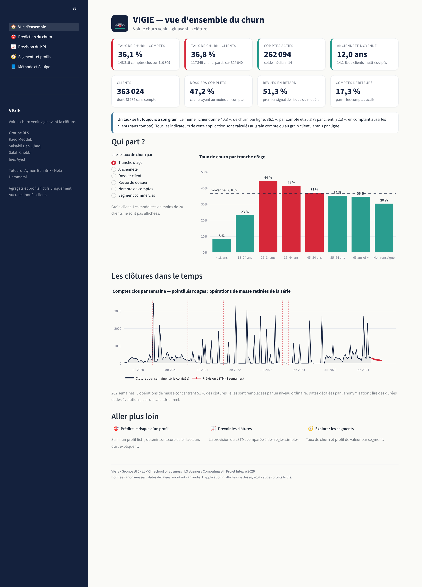
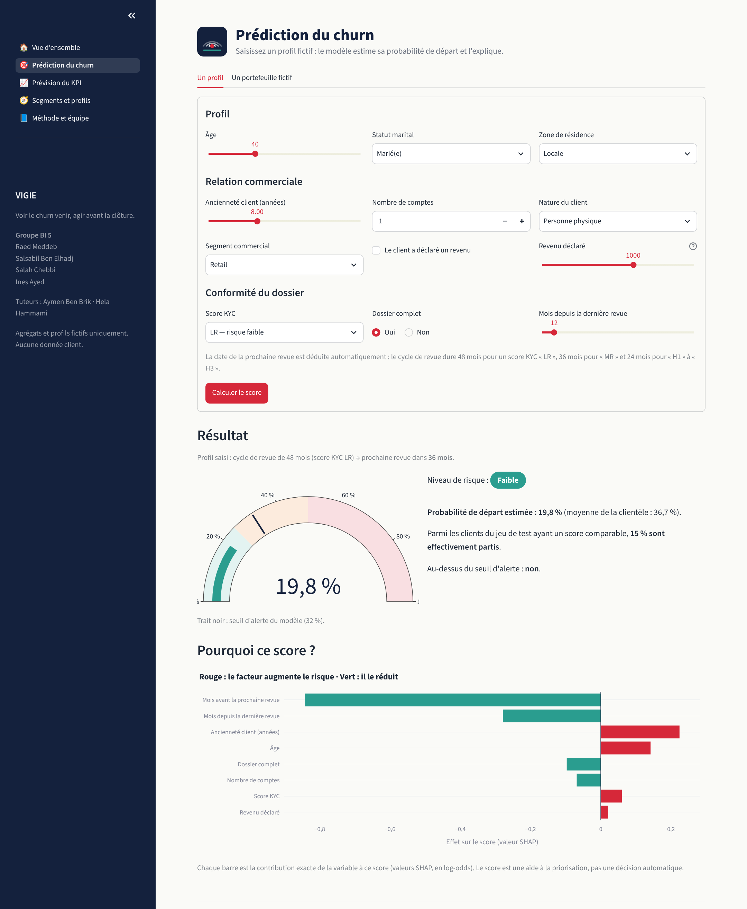
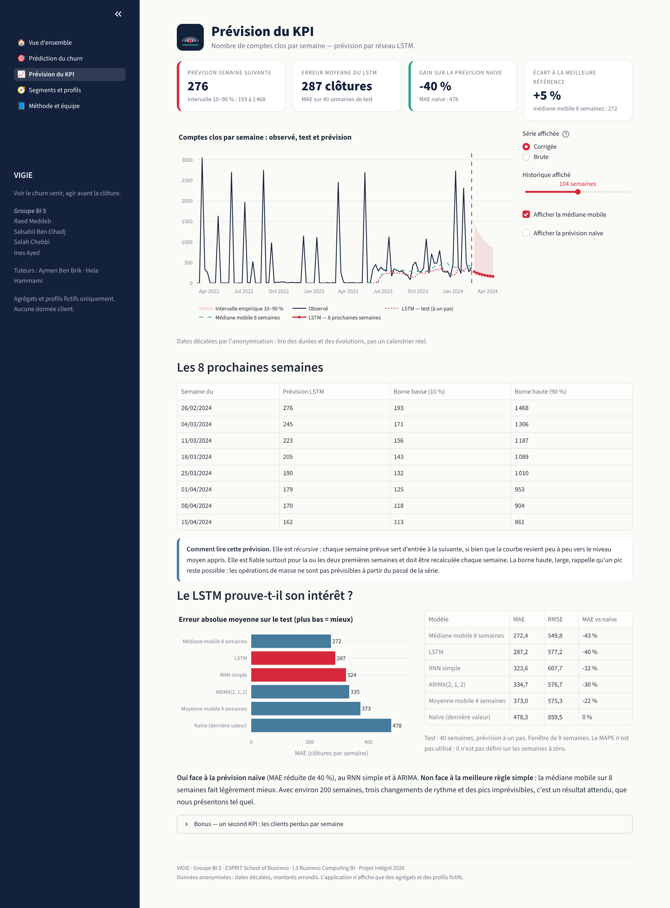
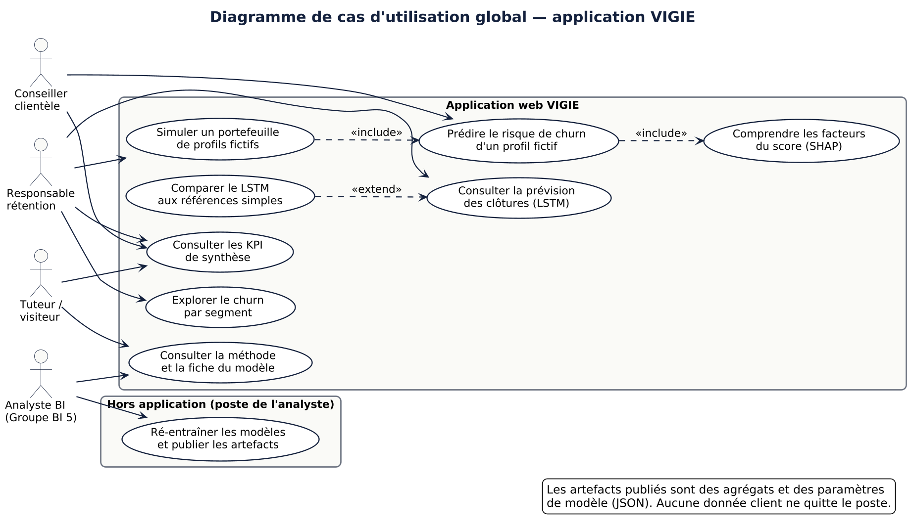
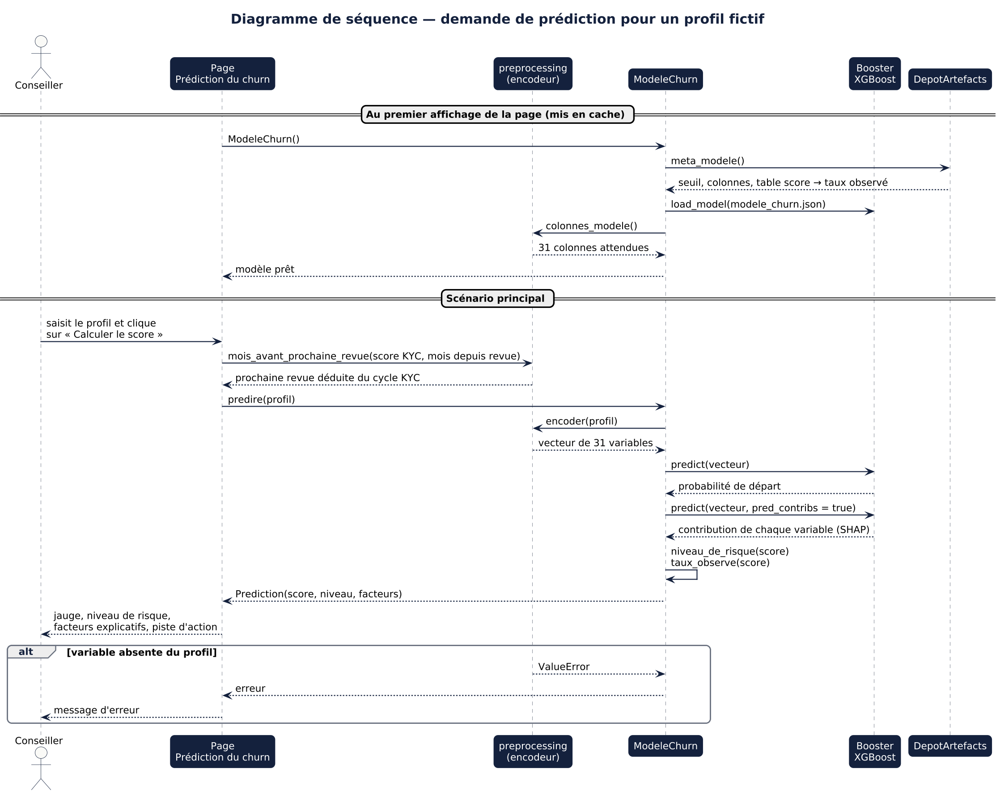
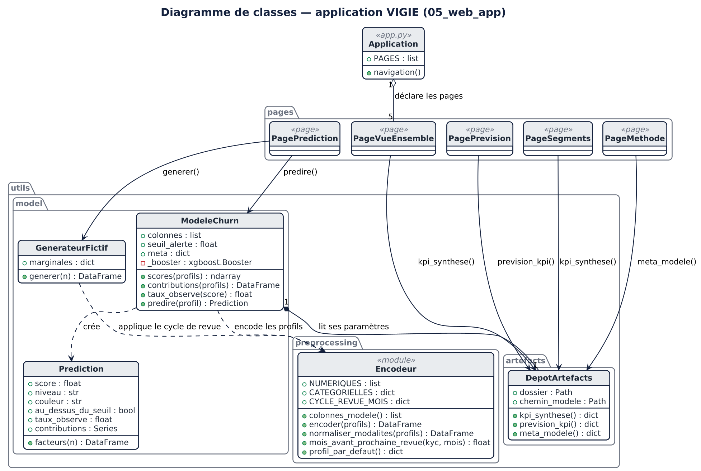

# 05 — Application web VIGIE

Interface **Streamlit** qui met les analyses à disposition des décideurs : indicateurs de synthèse, score de churn
expliqué, prévision des clôtures.

> **Application déployée :** l'URL est indiquée dans le [README principal](../README.md#application-déployée).
> Procédure de déploiement : [`DEPLOY.md`](DEPLOY.md).



## Les trois fonctionnalités demandées

| Fonctionnalité | Page | Ce qu'elle montre |
|---|---|---|
| **KPI de synthèse** | Vue d'ensemble | 8 indicateurs agrégés, taux de churn par axe, clôtures dans le temps |
| **Prédiction individuelle** | Prédiction du churn | formulaire de profil fictif → probabilité de départ, niveau de risque, facteurs explicatifs (SHAP), piste d'action |
| **Prévision du KPI** | Prévision du KPI | prévision LSTM des 8 prochaines semaines, intervalle, comparaison aux références simples |

Et deux pages complémentaires : **Segments et profils** (churn par axe, valeur des segments) et **Méthode et équipe**
(fiche du modèle, contrôle de fuite, protection des données). L'onglet *Un portefeuille fictif* génère des profils
fictifs et les classe par risque.

| Prédiction expliquée | Prévision du KPI |
|---|---|
|  |  |

## Structure

```
05_web_app/
├── app.py                      # point d'entrée : configuration et navigation
├── pages/
│   ├── 0_Vue_d_ensemble.py     # KPI de synthèse
│   ├── 1_Prediction_du_churn.py
│   ├── 2_Prevision_du_KPI.py
│   ├── 3_Segments_et_profils.py
│   └── 4_Methode_et_equipe.py
├── utils/
│   ├── preprocessing.py        # profil → 31 variables (code partagé avec l'entraînement)
│   ├── model.py                # ModeleChurn, Prediction, GenerateurFictif
│   ├── artefacts.py            # DepotArtefacts : lecture des fichiers JSON
│   └── charte.py               # identité visuelle et composants
├── artifacts/                  # agrégats et paramètres du modèle (JSON)
├── assets/                     # logo et captures d'écran
├── docs/uml/                   # 3 diagrammes UML (sources PlantUML + PNG)
├── tests/                      # 26 tests automatisés
├── requirements.txt
└── DEPLOY.md
```

## Diagrammes UML

Sources PlantUML dans [`docs/uml/`](docs/uml/) ; régénération : `java -jar plantuml.jar docs/uml/*.puml`.

### Cas d'utilisation global



### Séquence — la demande de prédiction



### Classes



## Protection des données

| Règle du projet | Comment elle est tenue |
|---|---|
| Aucune ligne client, aucun identifiant, aucun export | l'application ne lit que `artifacts/` : des agrégats et des paramètres |
| Uniquement des profils fictifs | le formulaire est saisi à la main ; le portefeuille est tiré de distributions marginales |
| Aucun petit effectif | toute modalité de moins de 20 individus est écartée à l'export |
| Aucun modèle sérialisé dans le dépôt | le modèle est publié en JSON d'arbres (seuils et valeurs de feuilles), sans observation |

Ces règles sont **vérifiées automatiquement** par `tests/test_confidentialite.py` à chaque envoi de code.

### Que contient `artifacts/` ?

| Fichier | Contenu | Produit par |
|---|---|---|
| `kpi_synthese.json` | indicateurs globaux, taux de churn par axe, segments | `04_machine_learning/notebooks/03_churn_ml.ipynb` |
| `prevision_kpi.json` | série hebdomadaire, prévisions, comparaison des modèles | `04_machine_learning/notebooks/02_lstm_rnn.ipynb` |
| `modele_churn.json` | arbres XGBoost | `03_churn_ml.ipynb` |
| `modele_churn_meta.json` | seuil, métriques, importance, distributions marginales | `03_churn_ml.ipynb` |

## Une prédiction cohérente avec l'entraînement

* `utils/preprocessing.py` est **le seul** code qui transforme un profil en variables. L'entraînement l'importe :
  il ne peut pas y avoir d'écart entre ce que le modèle a appris et ce qu'on lui présente.
* La prochaine revue est **déduite** de la dernière et du score KYC (cycle de 48, 36 ou 24 mois, constaté dans les
  données) : le formulaire ne permet pas de saisir un profil incohérent.
* L'explication affichée est exacte : valeur de base + somme des contributions = score (vérifié par un test).

## Tests et intégration continue (bonus DevOps)

```bash
pip install -r 05_web_app/requirements.txt pytest
```

```bash
pytest 05_web_app/tests -v
```

| Fichier | Ce qui est vérifié |
|---|---|
| `test_preprocessing.py` | colonnes figées, encodage, valeurs manquantes, modalités inconnues, cycle de revue |
| `test_model.py` | score entre 0 et 1, explication exacte, sens des effets, portefeuille fictif |
| `test_application.py` | l'application démarre, les 5 pages s'exécutent, le formulaire réagit |
| `test_confidentialite.py` | aucun fichier de données, aucun identifiant, aucun petit effectif, cohérence des volumes |

Le fichier [`.github/workflows/ci.yml`](../.github/workflows/ci.yml) rejoue ces tests à chaque `push` (GitHub Actions).
