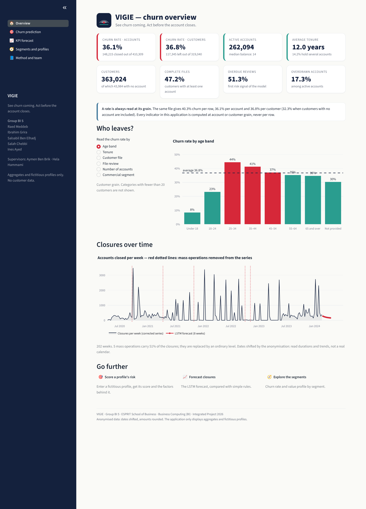
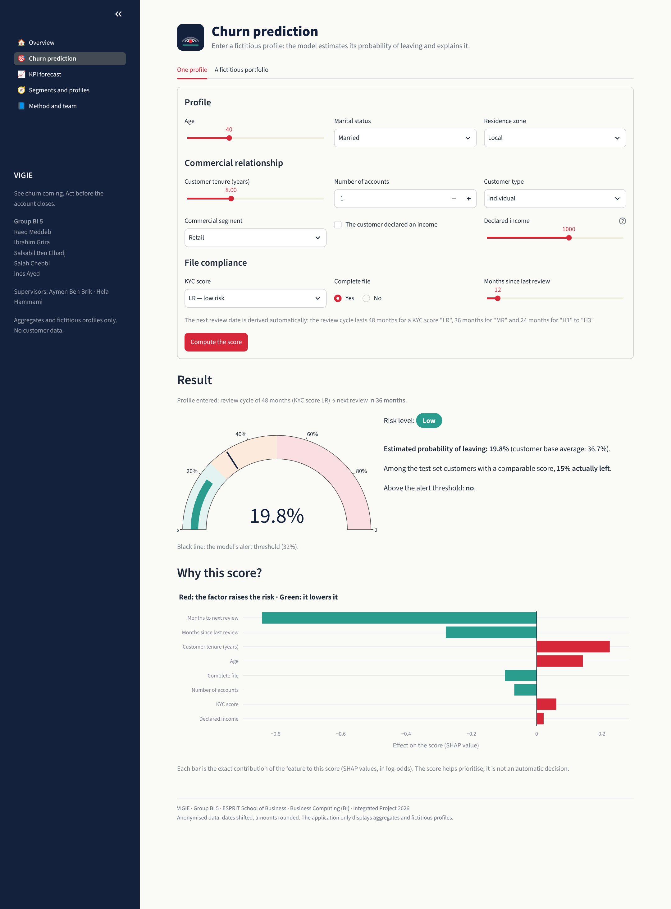
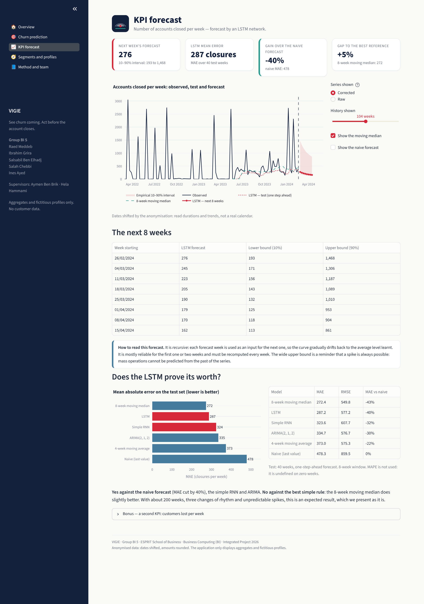
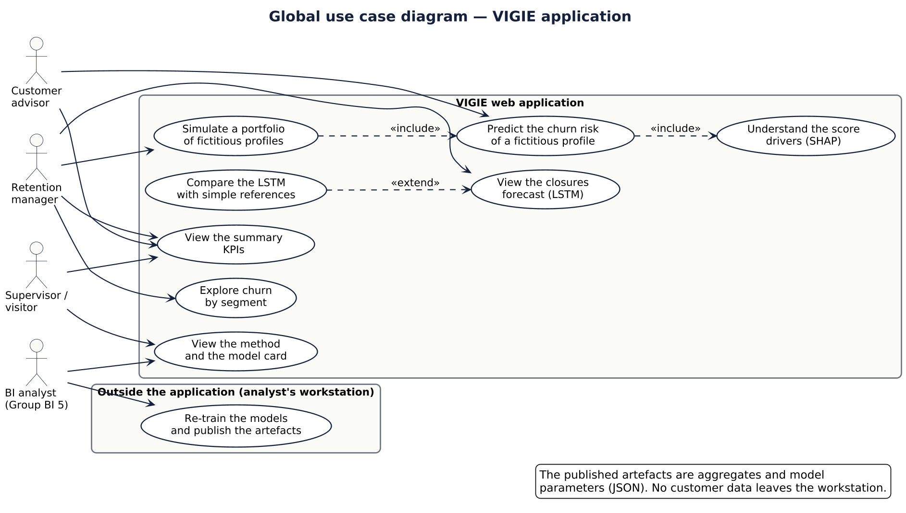
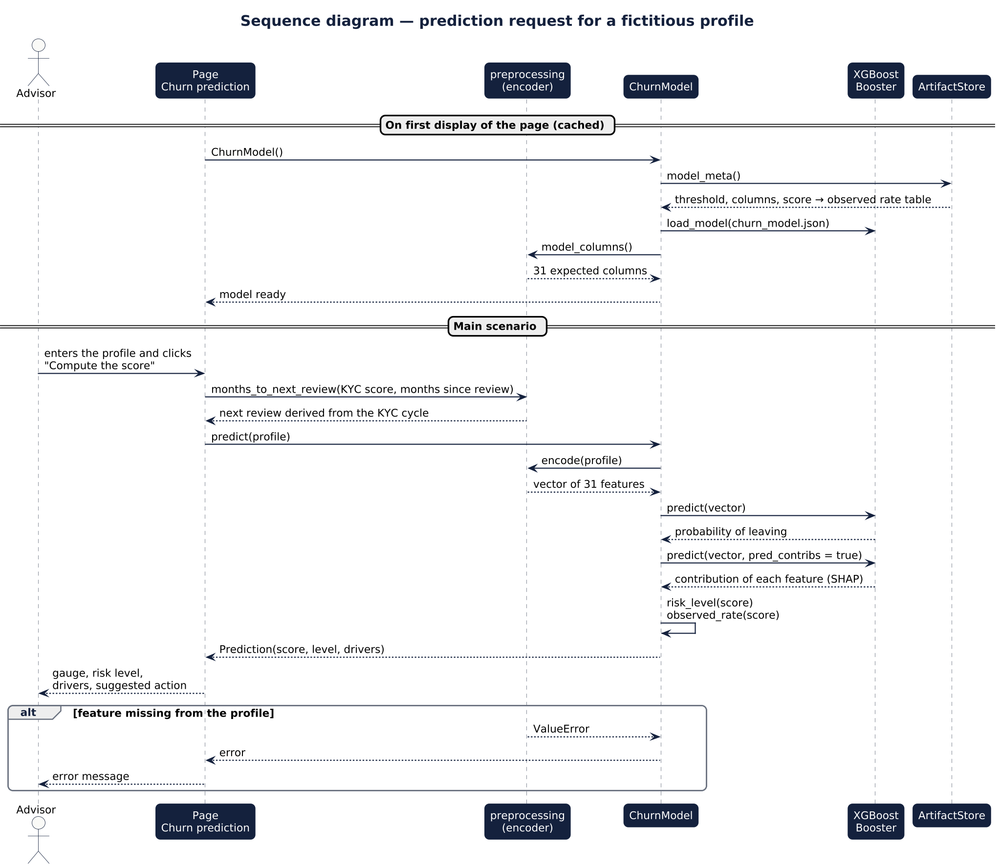

# 05 — VIGIE web application

**Streamlit** interface that puts the analyses in the hands of decision-makers: summary indicators, explained churn
score, closures forecast.

> **Deployed application:** the URL is given in the [main README](../README.md#deployed-application).
> Deployment procedure: [`DEPLOY.md`](DEPLOY.md).



## The three required features

| Feature | Page | What it shows |
|---|---|---|
| **Summary KPIs** | Overview | 8 aggregated indicators, churn rate by axis, closures over time |
| **Individual prediction** | Churn prediction | fictitious profile form → probability of leaving, risk level, drivers (SHAP), suggested action |
| **KPI forecast** | KPI forecast | LSTM forecast of the next 8 weeks, interval, comparison with simple references |

Two extra pages: **Segments and profiles** (churn by axis, segment value) and **Method and team** (model card,
leakage check, data protection, team). The *A fictitious portfolio* tab generates fictitious profiles and ranks them
by risk.

| Explained prediction | KPI forecast |
|---|---|
|  |  |

## Structure

```
05_web_app/
├── app.py                     # entry point: configuration and navigation
├── pages/
│   ├── 0_Overview.py          # summary KPIs
│   ├── 1_Churn_Prediction.py
│   ├── 2_KPI_Forecast.py
│   ├── 3_Segments.py
│   └── 4_Method_and_Team.py
├── utils/
│   ├── preprocessing.py       # profile → 31 features (code shared with training)
│   ├── model.py               # ChurnModel, Prediction, FictitiousGenerator
│   ├── artifacts.py           # ArtifactStore: reads the JSON files
│   └── theme.py               # visual identity and components
├── artifacts/                 # aggregates and model parameters (JSON)
├── assets/                    # logo and screenshots
├── docs/uml/                  # 3 UML diagrams (PlantUML sources + PNG)
├── tests/                     # 26 automated tests
├── requirements.txt
└── DEPLOY.md
```

## UML diagrams

PlantUML sources in [`docs/uml/`](docs/uml/); regenerate with `java -jar plantuml.jar docs/uml/*.puml`.

### Global use case



### Sequence — the prediction request



### Classes


## Data protection

| Project rule | How it is enforced |
|---|---|
| No customer row, no identifier, no export | the app only reads `artifacts/`: aggregates and parameters |
| Fictitious profiles only | the form is typed by hand; the portfolio is drawn from marginal distributions |
| No small counts | any category with fewer than 20 individuals is dropped at export |
| No serialised model in the repository | the model is published as JSON trees (thresholds and leaf values), no observation |

These rules are **checked automatically** by `tests/test_confidentiality.py` on every push.

### What does `artifacts/` contain?

| File | Content | Produced by |
|---|---|---|
| `kpi_summary.json` | overall indicators, churn rate by axis, segments | `04_machine_learning/notebooks/03_churn_ml.ipynb` |
| `kpi_forecast.json` | weekly series, forecasts, model comparison | `04_machine_learning/notebooks/02_lstm_rnn.ipynb` |
| `churn_model.json` | XGBoost trees | `03_churn_ml.ipynb` |
| `churn_model_meta.json` | threshold, metrics, importance, marginal distributions | `03_churn_ml.ipynb` |

## A prediction consistent with training

* `utils/preprocessing.py` is **the only** code that turns a profile into features. Training imports it: there can
  be no gap between what the model learnt and what it is shown.
* The next review is **derived** from the last one and the KYC score (48, 36 or 24-month cycle, found in the data):
  the form cannot produce an inconsistent profile.
* The displayed explanation is exact: base value + sum of contributions = score (checked by a test).

## Tests and continuous integration (DevOps bonus)

```bash
pip install -r 05_web_app/requirements.txt pytest
```

```bash
pytest 05_web_app/tests -v
```

| File | What is checked |
|---|---|
| `test_preprocessing.py` | fixed columns, encoding, missing values, unknown categories, review cycle |
| `test_model.py` | score between 0 and 1, exact explanation, direction of effects, fictitious portfolio |
| `test_application.py` | the app starts, the 5 pages run, the form reacts |
| `test_confidentiality.py` | no data file, no identifier, no small count, consistent volumes |

[`.github/workflows/ci.yml`](../.github/workflows/ci.yml) re-runs these tests on every push (GitHub Actions).
