<div class="cover">

<p class="school">ESPRIT School of Business<br>Bachelor Year 3 — Business Computing (BI)</p>
<h1 class="title">VIGIE</h1>
<p class="subtitle">Customer churn analysis and prediction<br>An end-to-end decision-support solution</p>
<p class="tagline">See churn coming. Act before the account closes.</p>
<div class="cover-block">
<p><b>Integrated Project — Group BI 5</b></p>
<p>Raed Meddeb · Ibrahim Grira · Salsabil Ben Elhadj · Salah Chebbi · Ines Ayed</p>
<p>Supervisors: <b>Aymen Ben Brik</b> and <b>Hela Hammami</b></p>
<p>Academic year 2026</p>
</div>
</div>

<div class="page-break"></div>

# Executive summary

**The question.** A financial institution provided an anonymised and generalised dataset describing 363,024 customers
and 410,309 accounts. Customer retention is a major issue for the sector: acquiring a new customer costs several times
more than keeping an existing one. Our mission was to design, end to end, a decision-support solution able to
**understand, measure and anticipate churn**, and to put it in the hands of business users.

**What we built.** VIGIE is a complete chain: a data quality analysis, a PostgreSQL data warehouse modelled as a star
schema and loaded by an ETL flow, a Power BI report documented measure by measure, two predictive models (an LSTM that
forecasts weekly closures and an XGBoost model that scores a customer's risk of leaving), and a Streamlit web
application. A shared Python library guarantees that every figure in the report, the warehouse and the application
comes from the same code.

**Key findings.**

| Topic | Finding |
|---|---|
| Grain | The churn rate is 40.3% per row, **36.1% per account** and **36.8% per customer**: a rate is meaningless without its grain. |
| Customers | No customer holds both an active and a closed account: a customer is either entirely active or entirely gone. |
| Target leakage | Ten columns (balance, account family, currency, opening date…) are blank for 68% of closed accounts and never for active ones. They record the departure rather than predict it, and are excluded. Kept, they would fake a ROC-AUC of 0.95. |
| Mass operations | Five weeks out of 202 carry **51% of all closures**: batch closures, not individual departures. |
| Drivers of churn | An **overdue file review** is the strongest warning sign; churn peaks at 25–44 years of age and 5–10 years of tenure; holding several accounts protects. The commercial segment barely matters. |

**Model results.**

* **Weekly closures (LSTM).** On the last 40 weeks, the LSTM cuts the error of the naive forecast by **40%**
  (MAE 287 vs 478) and beats a simple RNN and ARIMA. It does not beat an 8-week moving median (MAE 272): with only
  202 weeks, a regime change and unpredictable spikes, this is the expected result, and we demonstrate it rather
  than hide it.
* **Customer churn (XGBoost).** ROC-AUC **0.751**, PR-AUC **0.611**, recall **79%** at the alert threshold, with
  probabilities that are well calibrated (within 1.5 points per decile). Targeting the top 30% of scores reaches half
  of the departures.

**Recommendations.** (1) Put overdue file reviews at the heart of the retention routine; (2) use the score to
prioritise contacts, not to decide automatically; (3) monitor the weekly closures forecast next to a moving median,
and separate batch operations from genuine departures in the source systems; (4) enrich the model with behavioural
data (transactions, complaints, contacts), which is what limits it today.

# Contents

1. Introduction and context
2. Understanding the data
3. Architecture of the solution
4. Data warehouse and ETL
5. Power BI reporting and DAX
6. Predictive models
7. Web application, deployment and UML
8. Limitations and perspectives
9. Conclusion
10. Appendices

<div class="page-break"></div>

# 1. Introduction and context

## 1.1 The business problem

In retail banking, *churn* — the loss of a customer — weighs directly on revenue and on the cost of acquisition.
A customer who closes their accounts rarely comes back, and the reasons they give are often vague. The value of a
decision-support solution is therefore twofold: **measure** churn properly (how much, where, when) and **anticipate**
it (who is about to leave, how many closures to expect next week), so that retention teams act before the closure.

## 1.2 Objectives of the project

The project covers the whole BI chain, in five phases with a mandatory core and optional bonuses:

| Phase | Mandatory core | Bonus delivered |
|---|---|---|
| 1 · Data | Univariate analysis, missing values and outliers | Bivariate analysis |
| 2 · DWH / ETL | Star schema, Talend, PostgreSQL with pgAdmin | Python pipeline, SCD type 2 |
| 3 · Reporting | Power BI report, DAX measures | JavaScript interface |
| 4 · Prediction | KPI, time series analysis, LSTM / RNN, churn ML | Second KPI |
| 5 · Deployment | Web interface, 3 UML diagrams | Automated tests, continuous integration |

## 1.3 Constraints

The dataset is **anonymised and generalised**: random identifiers, neutral labels, branches merged into anonymous
groups, dates shifted and generalised, amounts rounded and capped, k-anonymity (k ≥ 5) on customer characteristics.
Three rules follow, which we applied throughout:

* the data never enters the repository nor any external service — only our code is shared;
* no attempt is made to identify the institution, a branch or a customer, and dates are read as **durations**,
  never as a calendar;
* the public application shows **aggregates and fictitious profiles only**.

## 1.4 Organisation of the team

| Member | Main role |
|---|---|
| Raed Meddeb | Project lead · churn modelling (Machine Learning) |
| Ibrahim Grira | Web application, UML and DevOps (tests, continuous integration) |
| Salsabil Ben Elhadj | Data warehouse and ETL (Talend, PostgreSQL) |
| Salah Chebbi | Time series and Deep Learning (LSTM) |
| Ines Ayed | Power BI reporting, DAX and data quality |

The work followed the five milestones of the timeline (9 November to 7 December 2026), with Git as the backbone:
`main` for the stable version and one `feature/...` branch per task.

<div class="page-break"></div>

# 2. Understanding the data

## 2.1 Integrity

The main file `data_churn.csv` was read as text, without letting the library guess types, and fingerprinted
(SHA-256 `858551b4…`). The four volumes stated by the supervisors were found to the unit: **483,536 rows,
32 columns, 363,024 customers, 410,309 accounts**. Every code of the five reference files (account families,
closure reasons, currencies, industry sections, lines of business) exists in its reference: no orphan key.
All dates in `YYYYMMDD` format convert without error.

## 2.2 Grain and keys

A row is a **customer / account / product match**: a customer or an account can appear several times. We
established that:

* an account always belongs to a single customer (a clean one-to-many relationship);
* when an account appears on several rows, only the closing date (11,807 accounts), more rarely the closure reason
  or the fixed rate, change; every other attribute is constant;
* 43,984 customers (9.1% of rows) have no account at all;
* 8,335 rows are strict duplicates.

**Decision.** Two analysis grains: the **account** (one row per `ACCOUNT_NO`, first closing date kept) for the
warehouse, the KPIs and the time series; the **customer** for segmentation and churn prediction.

## 2.3 Definition of churn

Following the description document, an account is churned when `ACCOUNT_STATUS = "Closed"`. A customer is churned
when **all** of their accounts are closed.

<figure>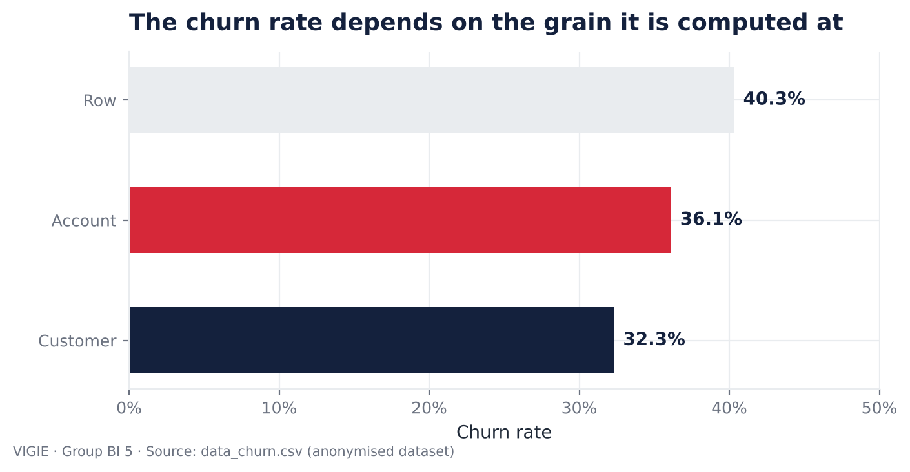<figcaption>Figure 1 — The churn rate depends on the grain at which it is computed.</figcaption></figure>

| Grain | Count | Churned | Churn rate |
|---|---:|---:|---:|
| Row (status filled in) | 439,552 | 177,270 | 40.3% |
| Account | 410,309 | 148,215 | 36.1% |
| Customer with at least one account | 319,040 | 117,345 | 36.8% |
| Customer (all, including no account) | 363,024 | 117,345 | 32.3% |

A key fact emerged: **no customer holds both an active and a closed account**. The definitions "all accounts
closed" and "at least one account closed" therefore coincide, which makes customer-level churn unambiguous. The
imbalance (36.8% positives) is moderate: no rebalancing is needed.

## 2.4 Missing values

<figure>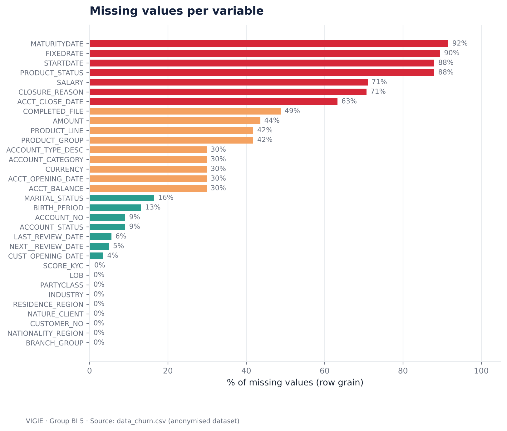<figcaption>Figure 2 — Share of missing values per variable (row grain).</figcaption></figure>

Not all blanks have the same meaning. We built a typology, measured by comparing active and closed accounts:

| Kind of blank | Variables | Explanation |
|---|---|---|
| Structural | every account column on the rows with no account | the customer has no account |
| Business | `ACCT_CLOSE_DATE`, `CLOSURE_REASON` | an active account has no closing date |
| Business | `STARTDATE`, `MATURITYDATE`, `FIXEDRATE`, `PRODUCT_STATUS` | only for products with a maturity (loans, term deposits) |
| **Tied to the closure** ⚠ | `ACCT_OPENING_DATE`, `ACCOUNT_CATEGORY`, `CURRENCY`, `ACCT_BALANCE`, `PRODUCT_GROUP`, `AMOUNT` | blank for 67.8% of closed accounts, **never** for active ones |
| Declarative / anonymisation | `SALARY`, `MARITAL_STATUS`, `BIRTH_PERIOD`, `COMPLETED_FILE` | not declared or masked |

The blanks "tied to the closure" are not a quality defect: **they give the target away**. This finding drives the
leakage check of phase 4.

## 2.5 Univariate analysis

<figure>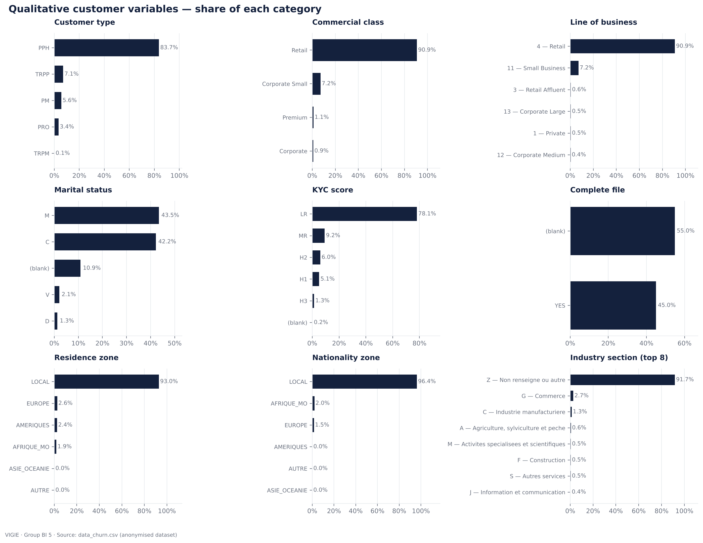<figcaption>Figure 3 — Qualitative customer variables.</figcaption></figure>

* The base is made of **individuals** (84% natural persons, 91% Retail segment). The `TRPP` / `TRPM` categories
  (7% of customers) almost never hold an account.
* `PARTYCLASS` and `LOB` carry the same information (Cramér's V = 1); residence and nationality are strongly linked.
* `COMPLETED_FILE` only takes `YES`: a blank means "incomplete file" (55% of customers).
* `INDUSTRY` is "not provided" for 92% of customers.

<figure>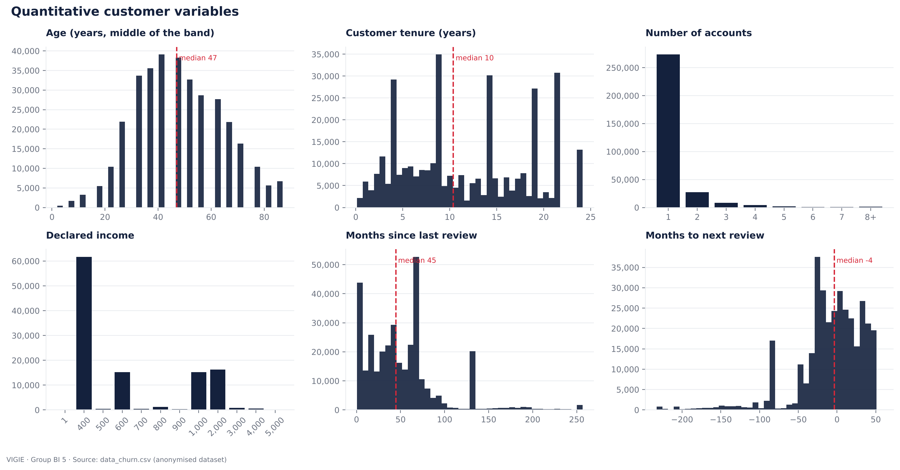<figcaption>Figure 4 — Quantitative customer variables.</figcaption></figure>

* **Age** (rebuilt at the middle of the 5-year birth band) centres around 47; **tenure** shows steps because the
  start of the relationship is generalised.
* **86% of customers hold a single account.**
* **Declared income** is rounded to one significant figure (a dozen values) and blank for 7 customers in 10.
* The last **file review** is, at the median, almost four years old; for half the customers the next review is overdue.

On the account side, savings dominate the portfolio, the local currency is used in the vast majority of cases, and
the declared closure reason is "Other" for 81% of closed accounts: **the declared reason does not explain churn**.

## 2.6 Outliers

Two methods were applied to every numeric variable: **IQR** (our reference, robust and distribution-free) and the
**z-score** (|z| > 3).

| Variable | IQR outliers | % | z-score outliers |
|---|---:|---:|---:|
| Account balance | 99,362 | 32.1% | 1,685 |
| Product amount | 51,236 | 20.0% | 852 |
| Fixed rate | 4,299 | 10.6% | 258 |
| Declared income | 17,899 | 15.9% | 1,620 |

<figure>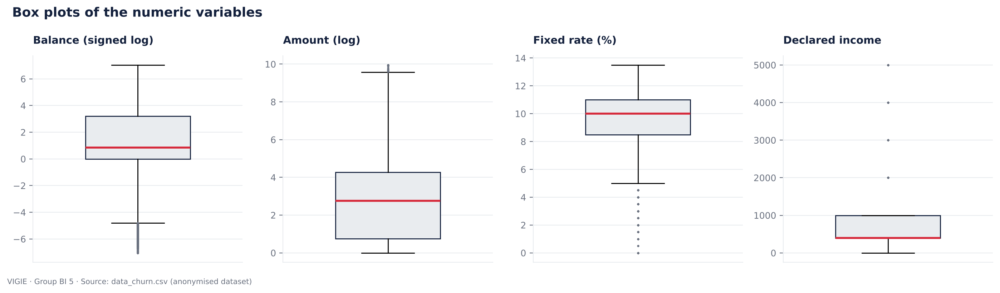<figcaption>Figure 5 — Box plots of the numeric variables.</figcaption></figure>

A third of balances fall outside the IQR bounds — but this is not a third of errors. Loan families have a negative
median balance and are ≈ 90% "out of bounds", simply because most accounts are small-balance savings, which narrows
the IQR interval to [−2,400 ; 4,000]. A negative balance is **business information** (an account in debit); the
extreme values come from the anonymisation cap (± 11,000,000). **Decision: no row is removed**; the warehouse adds an
`is_overdrawn` flag and analyses use medians and bands.

## 2.7 A date anomaly

Among closed accounts whose opening date is known, **20,166 (42%) have a closing date earlier than their opening
date**. The opening date cannot be trusted for closed accounts: the warehouse flags these accounts and does not
compute their age, and modelling uses the **customer's** tenure instead.

## 2.8 Bivariate analysis (bonus)

<figure>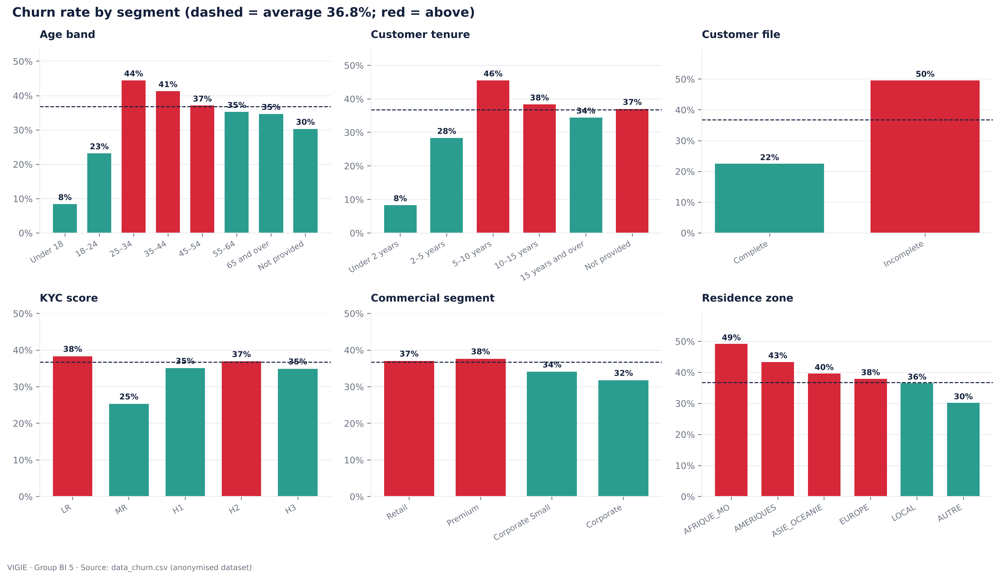<figcaption>Figure 6 — Churn rate by segment (red: above the 36.8% average).</figcaption></figure>

With 319,040 customers every test is significant, so we read the **strength** of the link (Cramér's V, univariate AUC):

| Variable | Strength | Reading |
|---|---:|---|
| Months since last / to next review | 0.34 / 0.33 | the most separating variables; churn doubles when the review is overdue (49.9% vs 23.0%) |
| Customer file | V = 0.28 | incomplete file: 49.6% churn vs 22.5% |
| Tenure band | V = 0.16 | bell-shaped: peak at 5–10 years (45.5%) |
| Age band | V = 0.14 | bell-shaped: peak at 25–34 (44.4%), minors 8.4% |
| Segment, industry, customer type | V ≤ 0.03 | churn affects every segment alike |

Two lessons for modelling: age and tenure have **non-linear** effects (tree models will capture them better), and
the compliance variables carry most of the signal — with the caveat that a neglected file may also be a
*consequence* of the departure, which we measure in phase 4.

<div class="page-break"></div>

# 3. Architecture of the solution

<figure>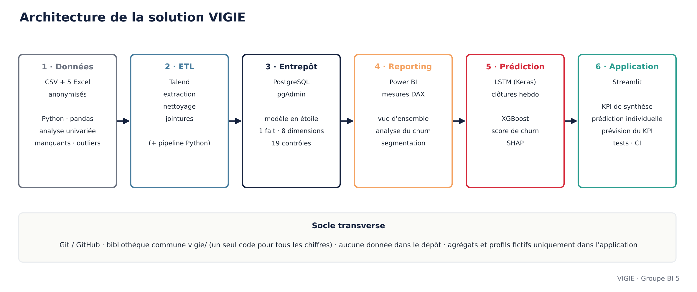<figcaption>Figure 7 — Architecture of VIGIE.</figcaption></figure>

The solution is a linear chain of six stages, resting on a cross-cutting foundation:

| Stage | Tools | Output |
|---|---|---|
| Data understanding | Python, pandas, Jupyter | 2 notebooks, variable summary table |
| ETL | Talend (mandatory), Python pipeline (bonus) | `staging` and `dwh` schemas loaded |
| Warehouse | PostgreSQL 16, pgAdmin | star schema, views, 19 checks |
| Reporting | Power BI, DAX; Chart.js (bonus) | 3-page report, JavaScript dashboard |
| Prediction | statsmodels, TensorFlow / Keras, scikit-learn, XGBoost, SHAP | LSTM, churn model, comparison tables |
| Application | Streamlit, Plotly; pytest, GitHub Actions | 5-page web application |

**Design principles.**

* **One code base for every figure.** The `vigie/` library defines the loading, the account and customer grains,
  the weekly series and the features. Notebooks, ETL and training import it; the application imports the same
  feature-encoding module as the training. A figure cannot differ between the report, the warehouse and the app.
* **Traceability.** Every figure is signed with the source; every exported artefact carries the SHA-256 of the source
  file; the notebooks are generated by a script that executes them top to bottom.
* **Reproducibility.** Fixed seeds; `train.py` re-trains both models and checks that the published metrics are
  reproduced exactly (they are).
* **Privacy by design.** Data stays in a git-ignored folder; the application only reads aggregates and model
  parameters; automated tests block any data file, identifier or small count.

<div class="page-break"></div>

# 4. Data warehouse and ETL

## 4.1 The star schema

<figure>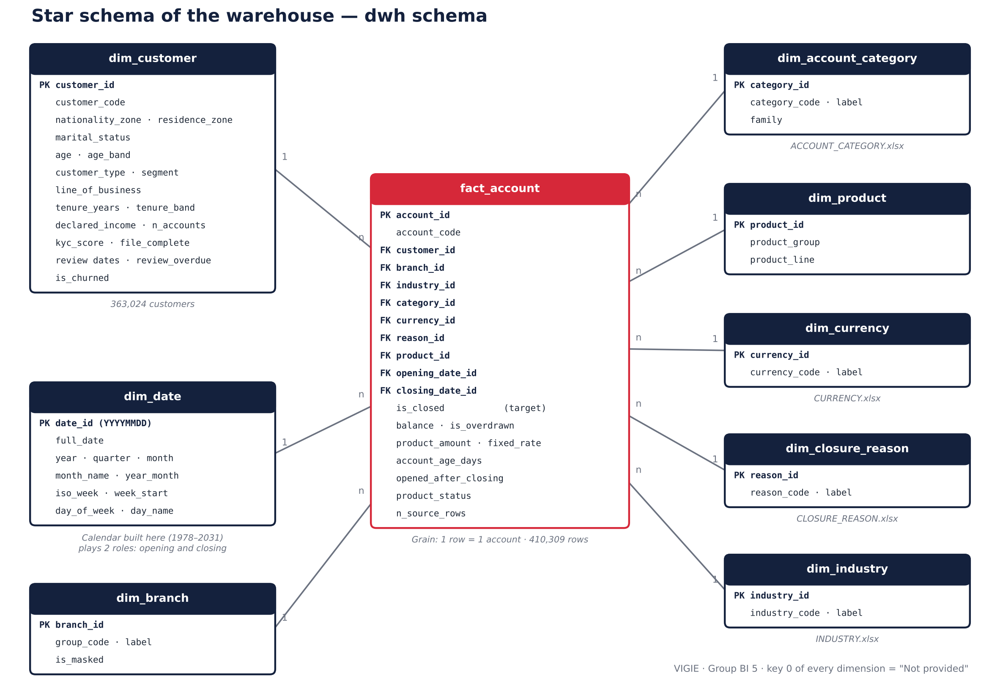<figcaption>Figure 8 — Star schema of the warehouse (dwh schema).</figcaption></figure>

**The grain: one row of `fact_account` = one account.** It is the grain of the target (churn is the closure of an
account), the finest stable grain, and it re-aggregates safely to the customer, the branch or the week. The fact table
holds the target `is_closed`, the balance and its `is_overdrawn` flag, the product amount and rate, the account age,
the anomaly flag `opened_after_closing` and `n_source_rows` (the number of CSV rows merged, for reconciliation).

**Eight dimensions**: customer, date (playing two roles: opening and closing), branch, industry, account category,
currency, closure reason and product.

**Design choices.**

1. **Customers with no account stay in the dimension** (`n_accounts = 0`, `is_churned = NULL`), so every customer can
   be counted without distorting churn rates.
2. **Key 0 = "Not provided"** in every dimension: no foreign key is ever null, no join loses rows, and Power BI shows
   "Not provided" instead of a blank — essential when a quarter of accounts have no family or currency.
3. **A calendar built in SQL** (`generate_series`, 1978–2031) with a `week_start` column giving the weekly grain.
4. **Derived variables computed once** (age, tenure, bands, months since review, review overdue) and stored in
   `dim_customer`, so Power BI, the models and the app read the same value.
5. **Anomalies flagged, not hidden** (`opened_after_closing`).

## 4.2 The ETL flow

<figure>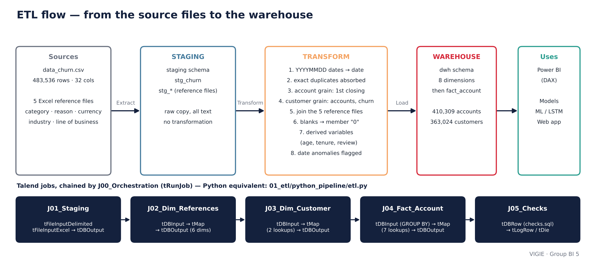<figcaption>Figure 9 — ETL flow and Talend jobs.</figcaption></figure>

| Rule | Detail |
|---|---|
| R1 Typing | `YYYYMMDD` dates → `date`; amounts → `numeric`; blanks kept as `NULL` |
| R2 Duplicates | the 8,335 exact duplicates are absorbed by the move to account grain |
| R3 Account grain | one row per account; **first** closing date; highest fixed rate when rows disagree (16 accounts) |
| R4 Customer grain | one row per customer; number of accounts; churn = all accounts closed |
| R5 Reference files | join of the 5 Excel files; missing code → key 0 |
| R6 Recoding | `COMPLETED_FILE` → boolean; codes → readable labels |
| R7 Derived variables | age, bands, tenure, months since review, review overdue |
| R8 Anomalies | opening later than closing → flag, age not computed |

**Talend.** The specification (`01_etl/talend/README.md`) details six jobs — `J01_Staging` (raw copy of the six
files), `J02_Dim_References`, `J03_Dim_Customer`, `J04_Fact_Account` (grain change by a `GROUP BY` query, seven
`tMap` lookups), `J05_Checks` (stops with `tDie` if a single check fails) and `J00_Orchestration` — component by
component, with every `tMap` expression and the expected row counts. The SQL given for the grain change was validated
against the warehouse: it reproduces the reference load on all 410,309 accounts.

**Python pipeline (bonus).** `01_etl/python_pipeline/etl.py` applies the same rules and loads PostgreSQL with `COPY`
in about 45 seconds. It is the reference against which the Talend jobs are accepted.

## 4.3 Checks: 19 out of 19

`checks.sql` compares the source (`staging`) with the target (`dwh`) and returns an OK / KO verdict per check:

| Family | Checks | Examples |
|---|---|---|
| Volumes | C01–C05 | 483,536 rows in staging; 410,309 accounts; 363,024 customers; sum of `n_source_rows` = 439,552 |
| Indicators | C06–C11 | 148,215 closed accounts; churn rate 36.12% on both sides; 117,345 churned customers; first closing date kept; sum of balances identical; weekly series total |
| Integrity | C12–C19 | no duplicate, no orphan fact, status consistent with closing date, anomalies flagged, `n_accounts` consistent, no mixed customer, every date in the calendar, no negative age |

**All 19 checks pass.** The share of facts pointing to "Not provided" (24.5% for family, currency and opening date)
matches exactly the blank rates measured in phase 1: nothing was lost or invented during the load.

## 4.4 KPI catalogue

Twenty KPIs are documented with their grain, SQL formula and reference value (`02_data_warehouse/kpis.md`), for
example: 410,309 accounts · 36.12% account churn rate · 36.78% customer churn rate · 11.98 years average tenure ·
median balance of active accounts 14 (the mean, −495, is distorted by large loan balances) · 51.28% overdue reviews.

## 4.5 SCD type 2 (bonus)

`dim_customer_scd2.sql` keeps the history of the attributes likely to change (KYC score, segment, complete file):
each change closes the current version (`valid_to`, `is_current = false`) and opens a new one. A stored procedure
performs the load; a demonstration on four fictitious customers and an "as of" query show the mechanism, ready for a
second snapshot.

<div class="page-break"></div>

# 5. Power BI reporting and DAX

## 5.1 The semantic model

The report imports the nine tables of the `dwh` schema. The seven dimension relationships are active; the **two
date relationships are inactive**: `dim_date` plays two roles, and an active relationship would make a date slicer
restrict every indicator (a "2023" filter would keep only accounts closed in 2023, and the churn rate would read
100%). Each time-based measure picks its role with `USERELATIONSHIP`. Identifiers are hidden from the report view.

## 5.2 The DAX measures

Thirty measures are documented in `03_power_bi/dax_measures.md`, each with its grain and the expected value
computed in SQL, so that the report can be checked number by number. A few examples:

```
Account Churn Rate  = DIVIDE ( [Closed Accounts], [Accounts] )                       -- 36.12%
Customer Churn Rate = DIVIDE ( [Churned Customers], [Customers With Account] )       -- 36.78%
Closures = CALCULATE ( [Closed Accounts],
                       USERELATIONSHIP ( fact_account[closing_date_id], dim_date[date_id] ) )
Risk Index = DIVIDE ( [Customer Churn Rate],
                      CALCULATE ( [Customer Churn Rate], REMOVEFILTERS ( dim_customer ) ) )
Share of the 5 Mass Weeks =
    VAR top_weeks = TOPN ( 5, ALL ( dim_date[week_start] ), [Closures], DESC )
    RETURN DIVIDE ( SUMX ( top_weeks, [Closures] ), CALCULATE ( [Closures], ALL ( dim_date ) ) )   -- 51.0%
```

Three rules make the measures right: a rate is always computed at its grain; the date relationships are inactive;
the "Not provided" member stays visible in charts by family, currency or product (68% of closed accounts no longer
have a family — hiding it would suggest that some families hardly churn).

## 5.3 The three pages

The build guide (`03_power_bi/build_guide.md`) describes every visual, field and interaction. The mockups below were
produced by our JavaScript dashboard from the same aggregates.

<figure>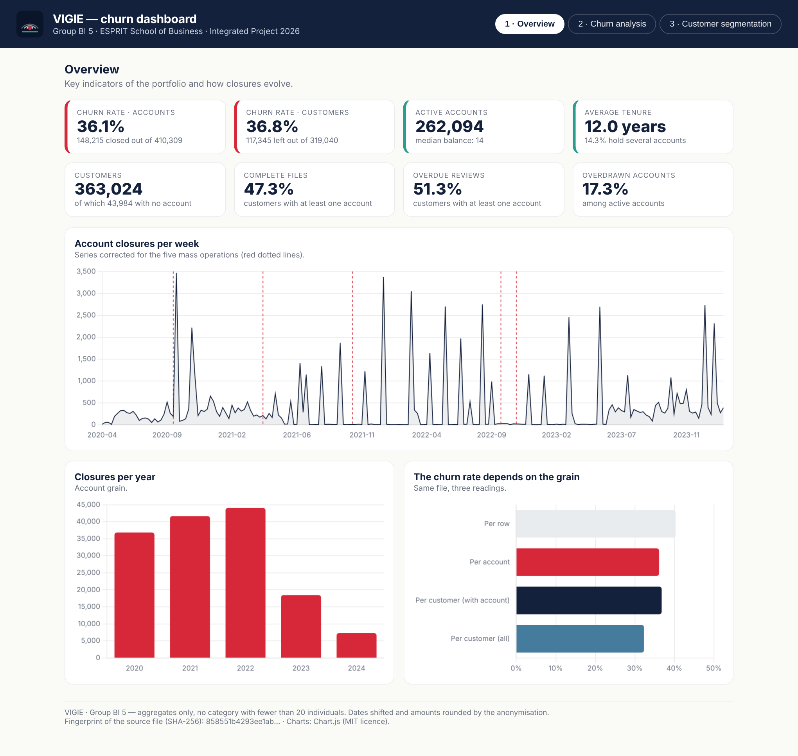<figcaption>Figure 10 — Page 1, Overview: 8 KPI cards, closures per week and per year, effect of the grain.</figcaption></figure>

<figure>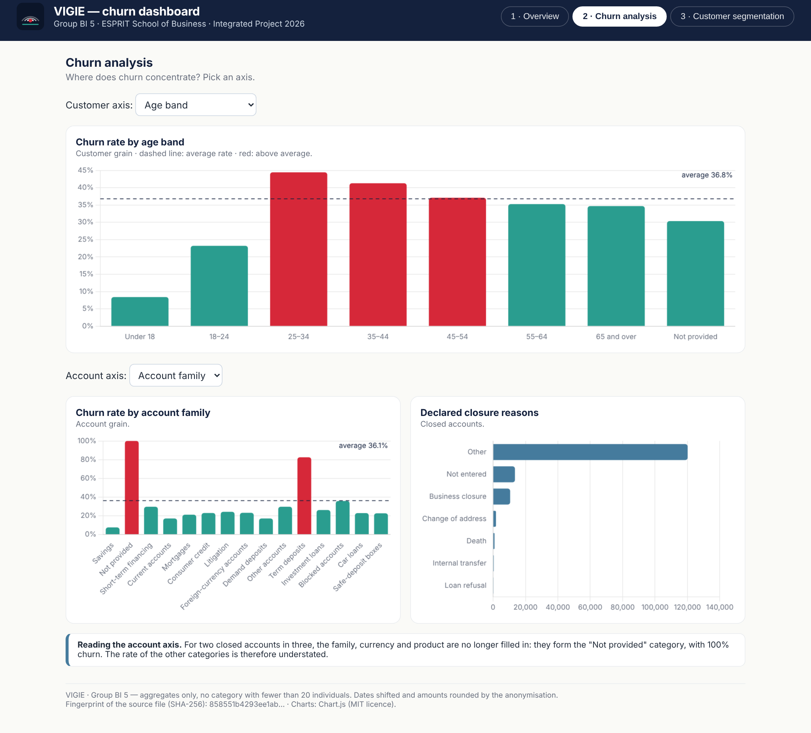<figcaption>Figure 11 — Page 2, Churn analysis: churn by age, tenure, compliance, product, currency and reason.</figcaption></figure>

<figure>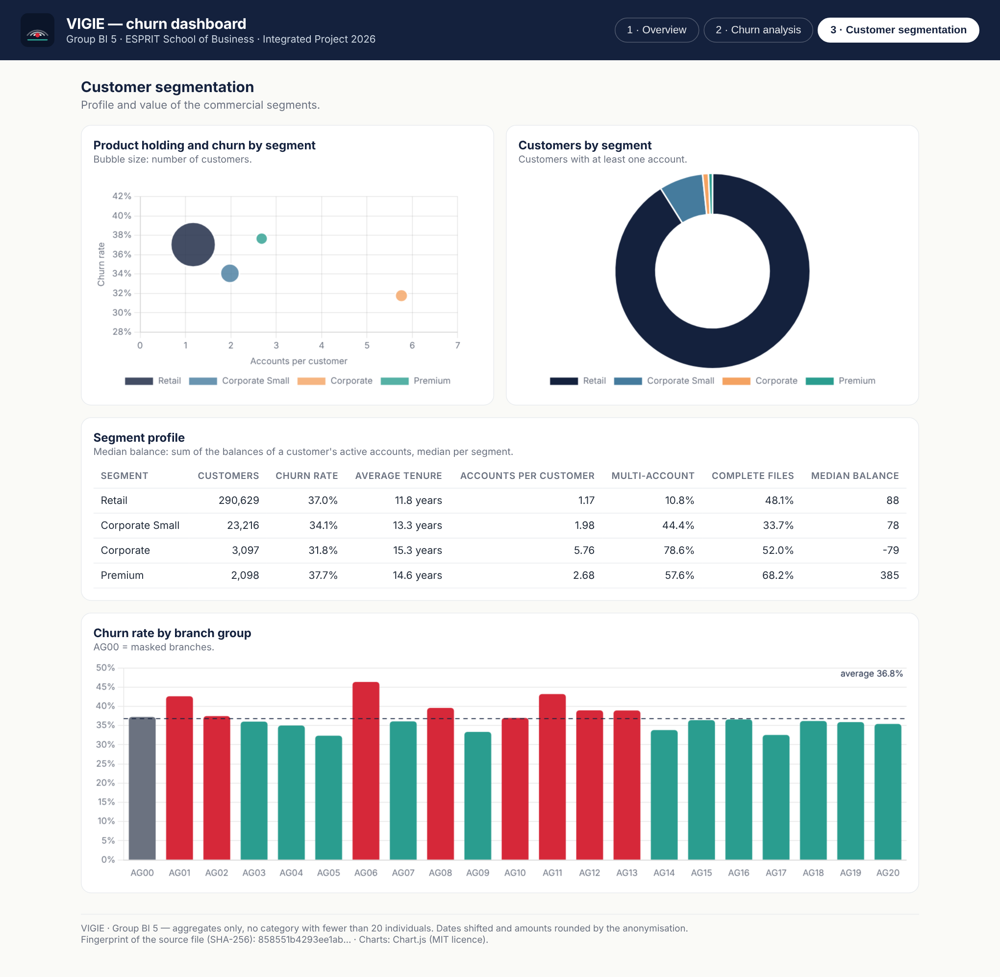<figcaption>Figure 12 — Page 3, Customer segmentation: product holding vs churn, segment profile, branches.</figcaption></figure>

Interactivity: page navigation buttons, synced slicers (segment, branch), drill-down year → quarter → month,
a decomposition tree on the customer churn rate, report tooltips and drill-through to the segmentation page.

## 5.4 JavaScript interface (bonus)

`03_power_bi/javascript_bonus/index.html` reproduces the three pages in a standalone web page (Chart.js). It opens
with a double-click, works offline, adapts to a phone screen, and is fed only by aggregates exported from the
application artefacts.

<div class="page-break"></div>

# 6. Predictive models

## 6.1 The KPI: weekly account closures

We chose the **weekly number of account closures**: it is the direct measure of churn, it is actionable (sizing the
retention and back-office teams, spotting an abnormal week) and it is available weekly — 202 points, whereas the
monthly series (47 points) would be too short for a recurrent network. A closure *rate* was ruled out: the stock of
open accounts cannot be rebuilt, since the opening date is blank for 68% of closed accounts.

The series is counted at **account grain** (counting rows would inflate it by 20%), on the **first** closing date,
and the **11 weeks with no closure are added as zeros**.

## 6.2 Analysis of the series

<figure>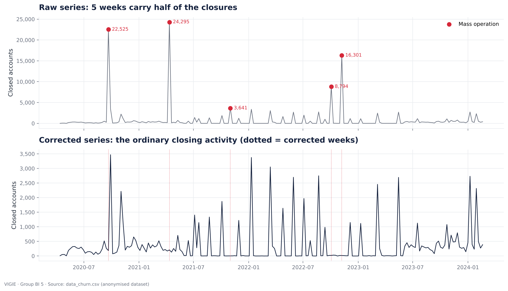<figcaption>Figure 13 — Raw series (top) and series corrected for the five mass operations (bottom).</figcaption></figure>

**Spikes.** Five weeks (2.5% of the series) carry **51% of all closures**. They are different in nature: the closure
reason is "Other" in 99.5% of cases (62% elsewhere) and 81% of the accounts have lost their balance information.
They are **batch closures**, a management decision that cannot be forecast from the past. Of the three options
(leave them, add an intervention variable that is only known after the fact, or correct the series), we **corrected
the series**: each mass week is replaced by the median of the four weeks before and after. We forecast the
ordinary closing activity, which is what the business can anticipate.

<figure>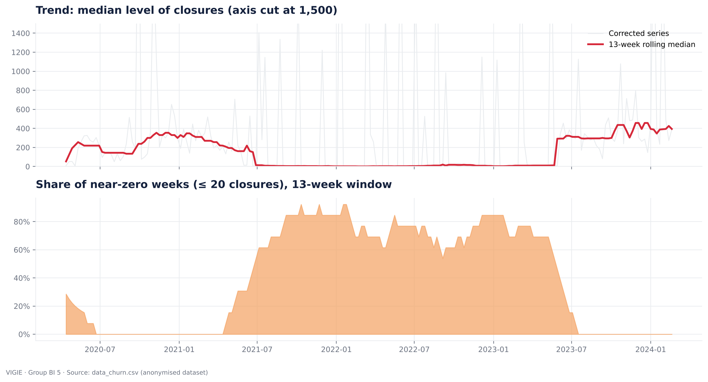<figcaption>Figure 14 — Trend and regimes: rolling median and share of near-zero weeks.</figcaption></figure>

**Trend and breaks.** There is no steady trend but **three regimes**: continuous flow (63 weeks, median 221),
batch processing (100 weeks, three in four almost empty, all the zero weeks), then continuous flow again at a higher
level (39 weeks, median 322). The test period coincides almost exactly with the third regime.

**Seasonality.** No annual cycle can be demonstrated on less than four years (and dates are shifted); no
"rank in the month" effect either.

<figure>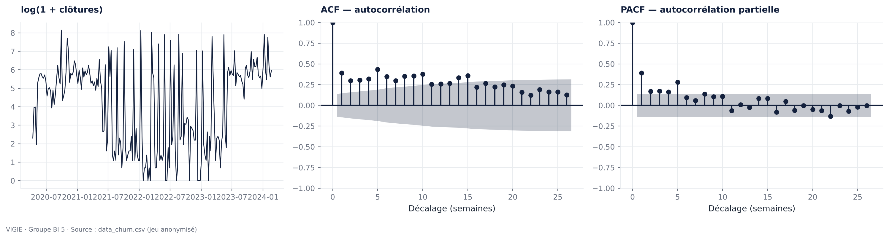<figcaption>Figure 15 — log(1 + closures), ACF and PACF.</figcaption></figure>

**Autocorrelation and stationarity.** The ACF decays slowly (regime persistence); the PACF is clear up to lag 5, with
an ACF peak at 5 weeks — the spacing of the batches. In logarithm the series is **not stationary** (ADF p = 0.70,
KPSS p = 0.04) and becomes stationary after one differencing.

**Modelling decisions**: `log(1 + x)` transform, absolute-error loss, **MAE and RMSE** (MAPE is undefined on zero
weeks), strict chronological split, **8-week sliding window**, ARIMA reference with `d = 1`, and a small network.

## 6.3 LSTM against simple references

**Protocol.** Training 142 weeks, validation 20 weeks (early stopping), test **the last 40 weeks**, never seen. The
normalisation is computed on the training part only. Every model forecasts one step ahead from the values actually
observed. Architecture: one LSTM (or simple RNN) layer of 32 units and a dense output (4,385 parameters for 134
training windows), Adam, MAE loss, early stopping with patience 30, three seeds.

<figure>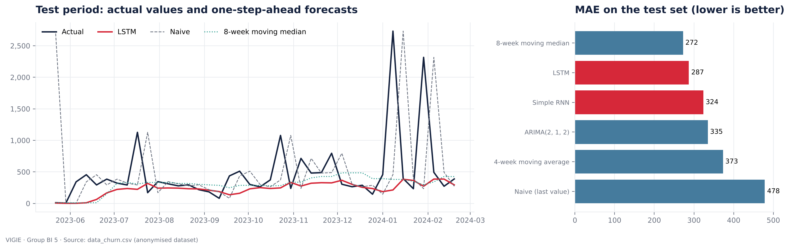<figcaption>Figure 16 — Test period: actual values and one-step-ahead forecasts (left); MAE of each model (right).</figcaption></figure>

| Model | MAE | RMSE | MAE vs naive |
|---|---:|---:|---:|
| 8-week moving median | 272.4 | 549.8 | −43% |
| **LSTM** (mean of 3 seeds, ± 6.4) | **287.2** | **577.2** | **−40%** |
| Simple RNN | 323.6 | 607.7 | −32% |
| ARIMA(2, 1, 2) | 334.7 | 576.7 | −30% |
| 4-week moving average | 373.0 | 575.3 | −22% |
| Naive (last value) | 478.3 | 859.5 | — |

**Does the LSTM prove its worth?** Against the naive forecast, clearly (−40% MAE). It also beats the simple RNN,
ARIMA and the moving average. It does **not** beat the 8-week moving median: the gap (15 closures) exceeds its
spread across seeds (± 6). Three reasons: little data (134 windows for 4,385 parameters), a regime change between
training and test (the normalised test series has a mean of +0.82), and spikes that do not depend on the past —
which a median ignores by construction. The error analysis confirms it: four spike weeks carry 55% of the error, and
on the 36 ordinary weeks the LSTM's error falls to 142 closures (368 for the naive forecast). The project guide
expected that "with about 200 points the LSTM may not win, which is acceptable if demonstrated".

<figure>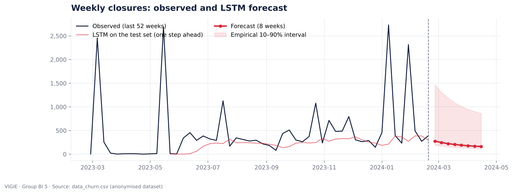<figcaption>Figure 17 — LSTM forecast of the next 8 weeks with an empirical 10–90% interval.</figcaption></figure>

The 8-week forecast is recursive and drifts back to the learnt level: it is useful mostly for the first one or two
weeks and must be recomputed weekly.

**Second KPI (bonus): customers lost per week.** The same code, applied to the week of each customer's last closure,
gives the **LSTM the best MAE** (124.5 vs 133.3 for the moving median, −45% vs naive).

## 6.4 Churn prediction: the leakage check first

The file is a snapshot taken **after** the closures. We tested every column by predicting the target with the single
flag "the value is missing":

<figure>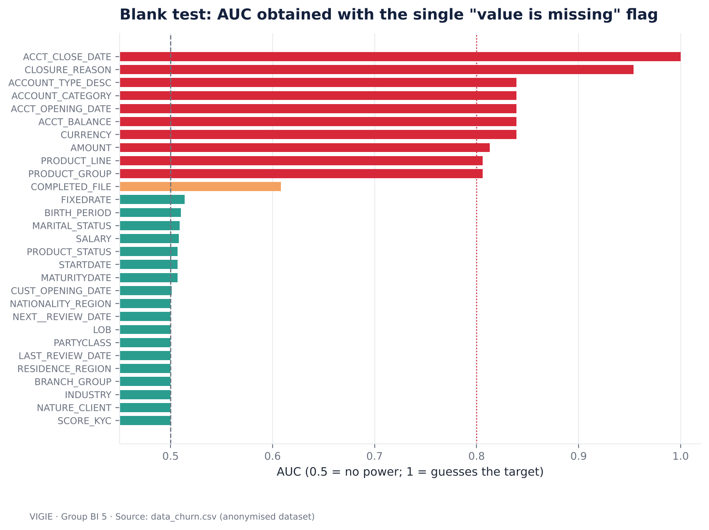<figcaption>Figure 18 — Blank test: AUC obtained with the single "value is missing" flag.</figcaption></figure>

* **Ten columns are excluded** (blank AUC ≥ 0.80): closing date and reason, balance, opening date, account family
  and description, currency, amount, product group and line.
* `PRODUCT_STATUS` is excluded for its **values**: `CLOSE` (99% closures), `UNAUTH` (87%), `PENDING.CLOSURE` (78%).
* `COMPLETED_FILE` (blank AUC 0.61) is kept as a customer characteristic, its weight measured separately.

**Demonstration.** Adding three blank flags to the model raises its ROC-AUC from **0.751 to 0.951**. A score close to
100% signals a model that reads the answer, not a good model.

## 6.5 Features, split and models

**Grain: the customer** (319,040 customers, 36.8% churn). **Twelve features**, all known before a departure:

| Family | Features |
|---|---|
| Demographics | age, marital status, residence zone |
| Relationship | customer tenure, number of accounts, customer type, segment, declared income |
| Compliance | KYC score, complete file, months since last review, months to next review |

We found that the review cycle is set by the KYC score (48 months for `LR`, 36 for `MR`, 24 for `H1`–`H3`, for 97 to
99% of customers): the next review is the last one plus the cycle. The application uses this rule to derive the next
review, which prevents inconsistent profiles.

**Split per customer** (`GroupShuffleSplit`, 70 / 15 / 15): no customer is shared between two sets. The decision
threshold is chosen on validation (maximum F1) and applied as is to the test set. No rebalancing: it would distort the
probabilities displayed by the application.

| Model | ROC-AUC | PR-AUC | Precision | Recall | F1 | Brier |
|---|---:|---:|---:|---:|---:|---:|
| Baseline (average rate) | 0.500 | 0.369 | — | — | — | 0.233 |
| Logistic regression | 0.686 | 0.538 | 0.518 | 0.676 | 0.586 | 0.209 |
| Random Forest | 0.748 | 0.607 | 0.515 | 0.813 | 0.631 | 0.193 |
| **Tuned XGBoost (kept)** | **0.751** | **0.611** | **0.526** | **0.790** | **0.632** | **0.192** |

<figure>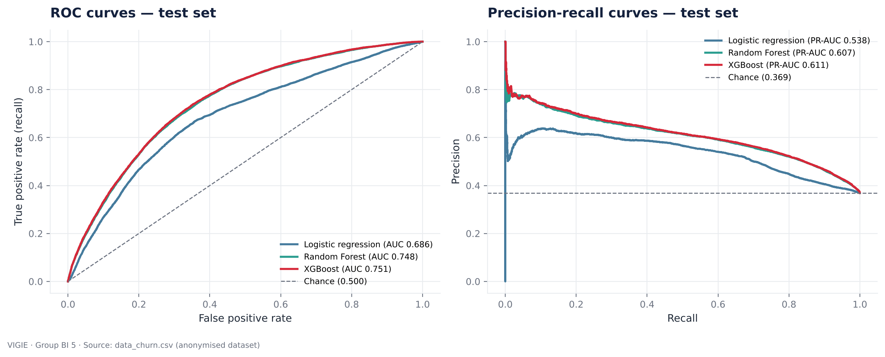<figcaption>Figure 19 — ROC and precision-recall curves on the test set.</figcaption></figure>

Tree models beat logistic regression by 0.06 of AUC — as expected from the bell-shaped effects of age and tenure.
At the threshold of 0.32, the model catches **79% of the leavers** with a precision of 53% (base rate 37%). Accuracy
(66%) is misleading: predicting "nobody leaves" already gives 63%.

**Tuning.** A random search (12 combinations, 3-fold cross-validation per customer) moves the PR-AUC only from 0.610
to 0.613: the ceiling comes from the information in the features, not from tuning. Little over-fitting: ROC-AUC
0.768 on training, 0.752 on validation, 0.751 on test.

## 6.6 Sensitivity, calibration, interpretability

| Scenario | ROC-AUC |
|---|---:|
| Model kept (12 features) | 0.751 |
| + industry and branch group | 0.756 |
| Without the two review features | 0.730 |
| Without the compliance family | 0.660 |
| Compliance only | 0.716 |
| Relationship only | 0.628 |
| Demographics only | 0.581 |

Compliance carries most of the signal; the three families complement each other. Industry and branch group would add
0.006 of AUC for 34 extra columns of anonymous codes: we left them out for a simpler model and form. Since a neglected
file may also follow a departure, we report both figures: **0.751 with the compliance features, 0.660 without**.

<figure>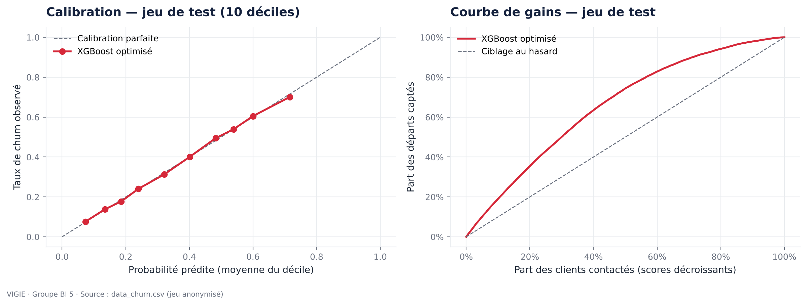<figcaption>Figure 20 — Calibration (left) and gains curve (right) on the test set.</figcaption></figure>

The model is **well calibrated** (within 1.5 points per decile): a 60% score means about six customers in ten leave,
so the probability can be displayed as is. **Gains**: the top 10% of scores capture 19% of departures (70% of them
are leavers); the top 20%, 35%; the top 30%, half. The three risk levels are well separated: 15.0% observed departures
in the low level, 37.9% in the moderate level, 60.9% in the high level.

<figure>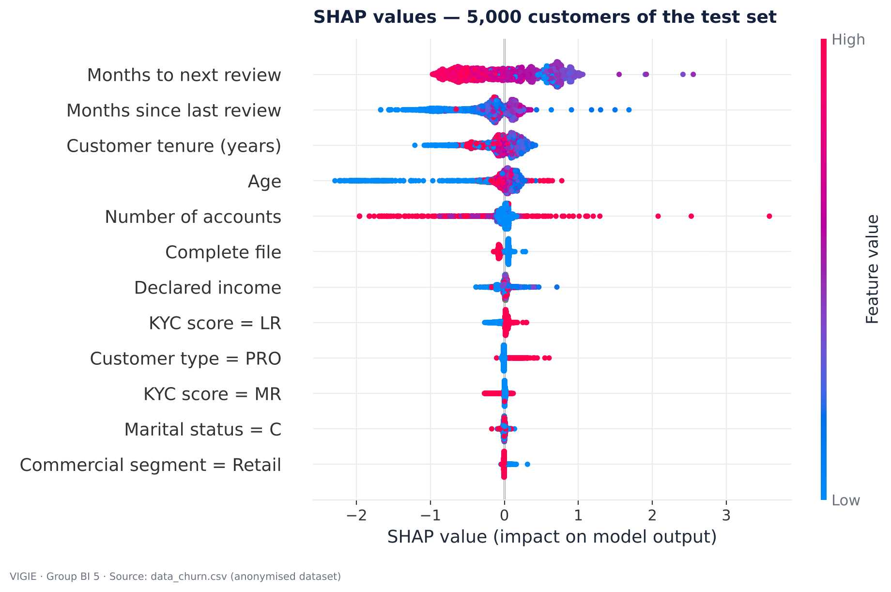<figcaption>Figure 21 — SHAP values on 5,000 test customers.</figcaption></figure>

| Factor | Mean SHAP effect | Business reading |
|---|---:|---|
| Next review overdue | +0.53 | the first warning sign: a file that is no longer followed |
| Last review less than 2 years ago | −0.53 | a recent review protects |
| Under 25 | −1.13 | the youngest leave very little |
| Tenure of 5 to 10 years | +0.20 | the fragile zone of the relationship |
| Two accounts or more | −0.20 | holding several accounts builds loyalty on average |

The two review features weigh 53% of the SHAP importance and the compliance family 62%; segment, customer type and
residence each weigh less than 2%.

**Model kept: tuned XGBoost** — the best performer, the best calibrated, it handles missing values natively, gives
exact SHAP explanations, and exports to a JSON file of trees (3 MB) that holds **no observation**, so it can be deployed
without any data.

<div class="page-break"></div>

# 7. Web application, deployment and UML

## 7.1 Features

The Streamlit application has five pages, built on the three required features:

| Page | Content |
|---|---|
| **Overview** (summary KPIs) | 8 aggregated indicators, churn rate by axis, closures over time with the LSTM forecast |
| **Churn prediction** | a form for a fictitious profile → probability of leaving, risk level, observed rate of similar test customers, the drivers of the score (exact SHAP values) and a suggested action; a tab generating a portfolio of fictitious profiles ranked by risk |
| **KPI forecast** | the LSTM forecast of the next 8 weeks with its interval, the comparison with every reference, the second KPI |
| **Segments and profiles** | churn by customer and account axis, closure reasons, segment value |
| **Method and team** | model card, leakage check, limitations, data protection, team |

<figure>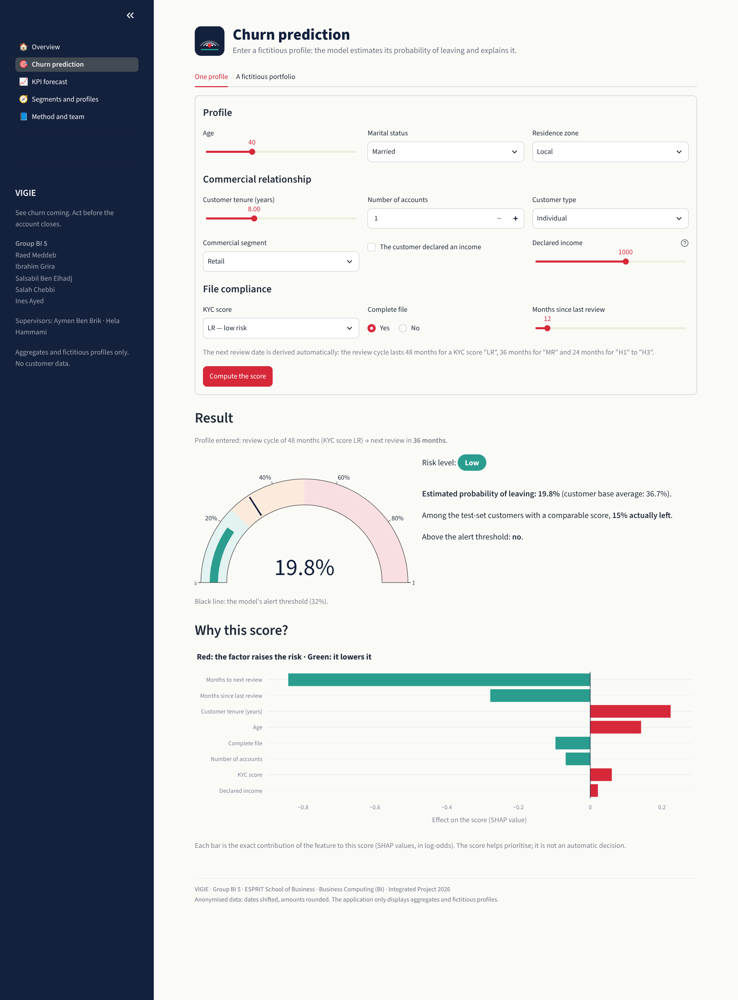<figcaption>Figure 22 — The prediction page: profile form, risk gauge and drivers of the score.</figcaption></figure>

## 7.2 Design choices

* **Consistency with training.** The application imports the same encoding module as the training code: what the
  model learnt and what it is shown are built identically.
* **No data.** The application only reads four JSON files: aggregates (no count below 20), weekly forecasts, the
  model trees and their metadata. Fictitious portfolios are drawn from marginal distributions, feature by feature,
  so that no profile matches a real customer.
* **Exact explanations.** A test checks that the base value plus the sum of the contributions gives back the score.

## 7.3 UML diagrams

<figure>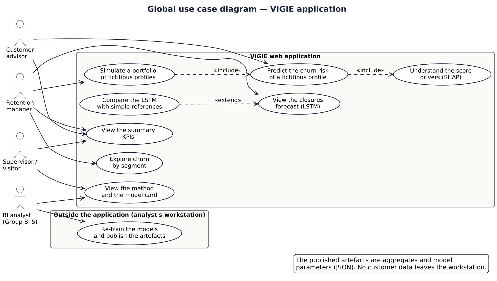<figcaption>Figure 23 — Global use case diagram.</figcaption></figure>

<figure>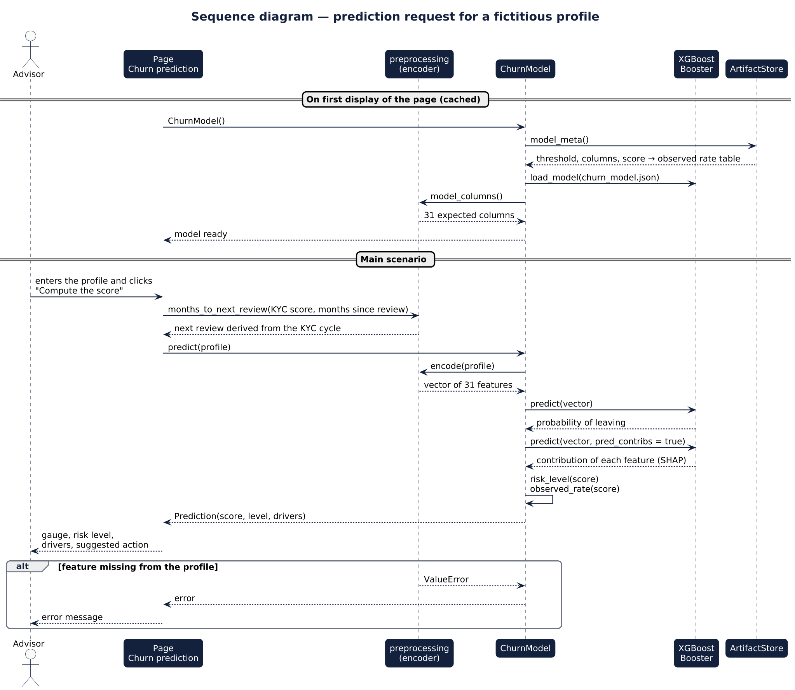<figcaption>Figure 24 — Sequence diagram of the prediction request.</figcaption></figure>

<figure>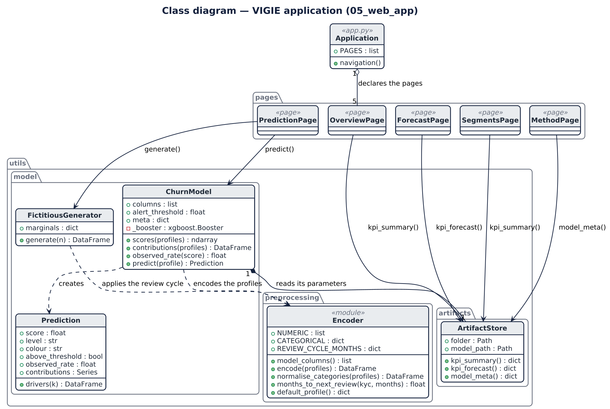<figcaption>Figure 25 — Class diagram of the application.</figcaption></figure>

## 7.4 Tests, continuous integration and deployment (bonus)

**26 automated tests** (pytest) cover the encoding (fixed columns, missing values, unknown categories, review cycle),
the model (probabilities, exact explanations, direction of the effects, fictitious portfolio), the application end to
end (every page runs, the form reacts in the right direction) and **data protection** (no data file or serialised
model in the repository, no customer or account identifier in any published file, no aggregate below 20 individuals,
consistent volumes across artefacts). A GitHub Actions workflow runs them on every push.

The application is designed for **Streamlit Community Cloud** (main file `05_web_app/app.py`); it needs neither
TensorFlow nor a `.pkl` file. The procedure is in `05_web_app/DEPLOY.md`; the public URL is reported in the README.

<div class="page-break"></div>

# 8. Limitations and perspectives

## 8.1 Limitations

* **The data is a snapshot, not a film.** Features are observed at the reference date, sometimes after the closure.
  We cannot fully exclude that the compliance features partly reflect the departure; we bound their effect (AUC 0.751
  with, 0.660 without).
* **Moderate predictive power (ROC-AUC 0.75).** The profile explains part of churn; behavioural signals
  (transactions, balances over time, complaints, contacts) are missing.
* **Mass operations.** Half of the closures are batch operations: part of what is called churn is a management
  decision, not a customer choice.
* **A short, changing time series.** 202 weeks and three regimes limit any forecasting model; the LSTM does not beat
  a robust moving median.
* **Anonymisation.** Shifted dates, rounded and capped amounts and generalised opening dates restrict the use of
  calendar effects and of amounts.
* **Tools requiring the team's licences or accounts.** The Talend export, the Power BI `.pbix` file and the public
  deployment are produced by the team from the specifications in the repository, and checked against the same
  reference values.

## 8.2 Perspectives

1. **Separate batch closures from genuine departures** in the source systems, and forecast both series.
2. **Add behavioural data** (monthly balances, transactions, complaints, channel usage) and rebuild the dataset as
   monthly snapshots, so that features are always observed *before* the outcome.
3. **Re-train regularly** as the current regime lengthens; monitor the LSTM next to the moving median and switch
   automatically to the better one.
4. **Measure the business value**: run a retention campaign on the top-scored customers against a control group.
5. **Industrialise**: schedule the ETL and the checks, load a second snapshot to exercise the SCD type 2 dimension,
   and put the application behind authentication to show at-risk lists on real customers internally.

<div class="page-break"></div>

# 9. Conclusion

VIGIE covers the whole decision-support chain required by the project — and each stage was verified rather than
assumed: the source file matches the stated volumes to the unit, the warehouse passes 19 reconciliation checks, every
DAX measure has a reference value, every published model metric is reproduced exactly by a script, and 26 tests guard
the application and the confidentiality rules.

Beyond the tools, the project taught us to **question the numbers before trusting them**: a churn rate depends on its
grain; blanks can give the target away and fake a near-perfect model; half of the closures are batch operations; and a
deep network does not automatically beat a well-chosen simple rule. Stating these results honestly is, we believe,
what makes the solution useful to a decision-maker.

The operational message is simple: **watch the files that are no longer reviewed**. An overdue review is the
strongest warning sign in the data, and it is something a bank can act on today.

<div class="page-break"></div>

# 10. Appendices

## A. Glossary

| Term | Meaning |
|---|---|
| Churn | Loss of a customer; here, the closure of an account (all accounts for a customer) |
| Grain | What one row represents (a row of the file, an account, a customer) |
| Star schema | A fact table surrounded by dimension tables |
| SCD type 2 | Dimension that keeps the history of changes with validity dates |
| Target leakage | Use of information that is only available because the outcome already happened |
| ROC-AUC / PR-AUC | Area under the ROC / precision-recall curve |
| SHAP | Method attributing to each feature its contribution to a prediction |
| LSTM / RNN | Recurrent neural networks for sequences (the LSTM has memory gates) |
| MAE / RMSE | Mean absolute error / root mean squared error |
| KYC | *Know Your Customer*: regulatory customer knowledge and its periodic review |

## B. Where to find each deliverable

| Deliverable | Location |
|---|---|
| Univariate and bivariate notebooks, variable summary | `01_etl/notebooks/`, `01_etl/variable_summary.md` |
| Talend specification, Python ETL, flow diagram | `01_etl/talend/`, `01_etl/python_pipeline/`, `01_etl/etl_flow.png` |
| SQL schema, checks and results, KPI catalogue, SCD type 2 | `02_data_warehouse/` |
| DAX measures, build guide, theme, mockups, JavaScript dashboard | `03_power_bi/` |
| Time series, LSTM and churn notebooks, model code, comparison tables | `04_machine_learning/` |
| Web application, UML, tests, deployment guide | `05_web_app/` |
| Slides and speaker notes | `07_presentation/` |

## C. Key commands

```
pip install -r requirements.txt
python 01_etl/python_pipeline/etl.py               # load the warehouse
python 02_data_warehouse/checks/check_report.py    # 19 checks
python 04_machine_learning/src/train.py            # re-train and verify the models
streamlit run 05_web_app/app.py                    # the application
pytest 05_web_app/tests                            # 26 tests
```

## D. References

* Project documents provided by the supervisors: project description, data description, timeline, student guide (2026).
* Kimball, R. & Ross, M. *The Data Warehouse Toolkit*, 3rd ed., Wiley, 2013.
* Hochreiter, S. & Schmidhuber, J. "Long Short-Term Memory", *Neural Computation* 9(8), 1997.
* Chen, T. & Guestrin, C. "XGBoost: A Scalable Tree Boosting System", *KDD*, 2016.
* Lundberg, S. & Lee, S.-I. "A Unified Approach to Interpreting Model Predictions", *NeurIPS*, 2017.
* Hyndman, R. J. & Athanasopoulos, G. *Forecasting: Principles and Practice*, 3rd ed., OTexts, 2021.
* Kaufman, S., Rosset, S. & Perlich, C. "Leakage in Data Mining: Formulation, Detection, and Avoidance", *KDD*, 2011.
* Documentation of pandas, scikit-learn, XGBoost, SHAP, TensorFlow / Keras, statsmodels, PostgreSQL, Streamlit.
