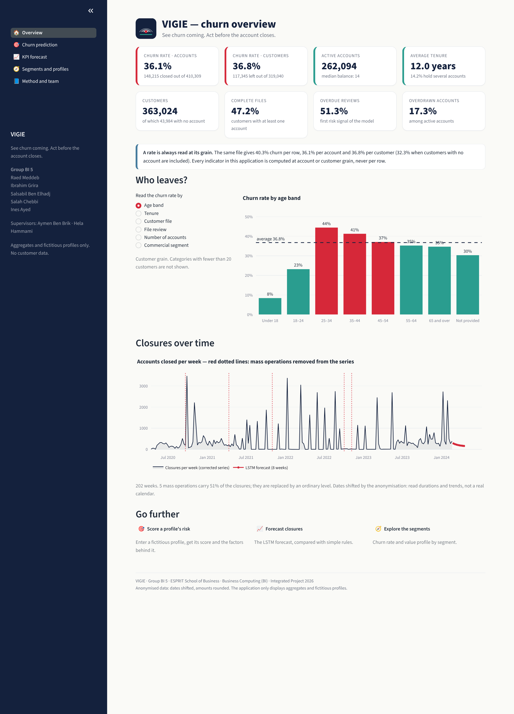
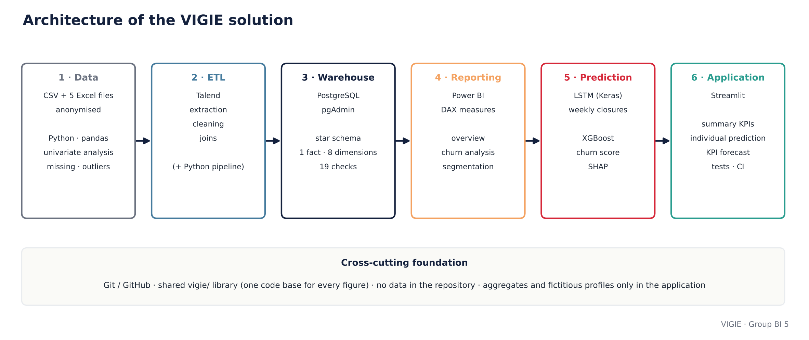

<p align="center"></p>

<h1 align="center">VIGIE — Customer churn analysis and prediction</h1>
<p align="center"><i>See churn coming. Act before the account closes.</i></p>

<p align="center">
Integrated Project · <b>ESPRIT School of Business</b> · Bachelor Year 3, Business Computing (BI) · 2026<br>
<b>Group BI 5</b> · Supervisors: <b>Aymen Ben Brik</b> and <b>Hela Hammami</b>
</p>

---

**VIGIE** (French for *lookout*: the watch posted to spot trouble early) is an end-to-end decision-support solution
that understands, measures and anticipates customer churn on the anonymised banking dataset provided for the project:
from data quality analysis to a PostgreSQL star schema, Power BI reporting, an LSTM forecast of weekly closures,
an explained churn score, and a web application.

## Team

| Member | Main role | Email |
|---|---|---|
| **Raed Meddeb** | Project lead · Churn modelling (Machine Learning) | raed.meddeb@esprit.tn |
| **Ibrahim Grira** | Web application, UML & DevOps (tests, CI) | ibrahim.grira@esprit.tn |
| **Salsabil Ben Elhadj** | Data Warehouse & ETL (Talend, PostgreSQL) | BenElhadj.Salsabil@esprit.tn |
| **Salah Chebbi** | Time series & Deep Learning (LSTM) | salah.chebbi@esprit.tn |
| **Ines Ayed** | Power BI reporting, DAX & data quality | ines.ayed@esprit.tn |

Supervisors: Aymen Ben Brik (aymen.benbrik@esprit.tn) · Hela Hammami (hela.hammami@esprit.tn)

## Deployed application

> **URL: _to be filled in after deployment_** — see [`05_web_app/DEPLOY.md`](05_web_app/DEPLOY.md)
> (Streamlit Community Cloud, main file `05_web_app/app.py`).



## Key results

| Phase | Result |
|---|---|
| **1 · Data** | File verified to the unit (483,536 rows · 363,024 customers · 410,309 accounts). Churn rate **40.3% per row, 36.1% per account, 36.8% per customer** — and no customer with both an active and a closed account. Blanks "tied to the closure" identified as a **target leak**. |
| **2 · DWH / ETL** | PostgreSQL star schema at **account grain** (1 fact table, 8 dimensions, calendar built in SQL). **19 source ↔ warehouse checks, 19 OK.** A source anomaly (20,166 accounts closed "before" they were opened) flagged, not hidden. |
| **3 · Reporting** | 30 DAX measures, each documented with its expected value; 3-page build guide; JavaScript dashboard (bonus). |
| **4 · Prediction** | **KPI:** weekly account closures. 5 mass-operation weeks carry 51% of closures and are corrected. The **LSTM cuts the error of the naive forecast by 40%** (MAE 287 vs 478) — but does not beat an 8-week moving median (272), which we demonstrate and explain. **Churn:** XGBoost on 12 profile features, **ROC-AUC 0.751, PR-AUC 0.611, recall 79%**, well calibrated. Leakage check: adding three blank flags would fake an AUC of 0.95. |
| **5 · Application** | Streamlit app: summary KPIs, explained prediction (SHAP) on fictitious profiles, LSTM forecast. 3 UML diagrams. **26 automated tests** + GitHub Actions. |

## Repository structure

| Folder | Content |
|---|---|
| [`00_documentation/`](00_documentation/) | Documents provided by the supervisors (unchanged) |
| [`01_etl/`](01_etl/README.md) | Univariate and bivariate analysis notebooks, variable summary, Talend job specification, Python ETL, flow diagram |
| [`02_data_warehouse/`](02_data_warehouse/README.md) | PostgreSQL scripts, star schema, 19 checks and their results, KPI catalogue, SCD type 2 (bonus) |
| [`03_power_bi/`](03_power_bi/README.md) | DAX measures, report build guide, theme, mockups, JavaScript dashboard (bonus) |
| [`04_machine_learning/`](04_machine_learning/README.md) | Time series, LSTM / RNN and churn notebooks, model code, comparison tables |
| [`05_web_app/`](05_web_app/README.md) | Streamlit application, UML diagrams, tests, deployment guide |
| [`06_rapport/`](06_rapport/README.md) | Report sources and final PDF |
| [`07_presentation/`](07_presentation/README.md) | Slides and speaker notes |
| [`vigie/`](vigie/) | Shared Python library: identity, loading, grains, weekly series, features — one code base for every figure |
| [`tools/`](tools/) | Notebook builder, diagram generator, dashboard export |
| `data/` | Local data folder — **never versioned** (see [`data/README.md`](data/README.md)) |

## Architecture



## Installation and reproduction

```bash
git clone https://github.com/raed1205/projet-integre-churn.git
```

```bash
cd projet-integre-churn
```

```bash
python -m venv venv
```

```bash
source venv/bin/activate
```

On Windows, activate with `venv\Scripts\activate` instead.

```bash
pip install -r requirements.txt
```

Then copy the six files provided by the supervisors into `data/` (see [`data/README.md`](data/README.md)).

| Step | Command |
|---|---|
| Load the warehouse (Python reference load; requires PostgreSQL) | `python 01_etl/python_pipeline/etl.py` |
| Check the load (19 checks) | `python 02_data_warehouse/checks/check_report.py` |
| Re-train both models and check the published results | `python 04_machine_learning/src/train.py` |
| Re-execute a notebook | `jupyter nbconvert --to notebook --execute --inplace <notebook>` |
| Run the application | `streamlit run 05_web_app/app.py` |
| Run the tests | `pytest 05_web_app/tests` |

PostgreSQL connection settings are read from `PGHOST`, `PGPORT`, `PGDATABASE`, `PGUSER` and `PGPASSWORD`
(no password in the code). Results are deterministic (fixed seeds): `train.py` reproduces the published metrics exactly.

## Data protection

* **No data in the repository**: `.gitignore` excludes `data/`, `*.csv`, `*.xlsx`, `*.pkl`, `*.keras`, `*.pbix`;
  a test (`05_web_app/tests/test_confidentiality.py`) fails if such a file or a customer/account identifier is ever
  committed.
* **Aggregates only** in notebooks, report and application; no aggregate below 20 individuals.
* **Fictitious profiles only** in the application; the churn model is published as JSON trees (decision rules, no
  observation).
* No attempt is made to identify the institution, a branch or a customer; dates are read as durations, never as a
  calendar.

## Mandatory items and bonuses

| Phase | Mandatory | Done | Bonus done |
|---|---|---|---|
| 1 | Univariate analysis, missing values and outlier counts | ✔ | Bivariate analysis |
| 2 | Star schema, Talend, PostgreSQL / pgAdmin | ✔ schema, SQL, checks, Talend job specification ⚠ Talend export to add | Python pipeline, SCD type 2 |
| 3 | Power BI report, DAX KPIs | ✔ measures and build guide ⚠ `.pbix` to build and hand in | JavaScript interface |
| 4 | KPI, time series analysis, LSTM / RNN, churn ML | ✔ | Second KPI |
| 5 | Web interface, 3 UML diagrams | ✔ ⚠ deployment URL to add | Tests and CI |

⚠ = steps that require the team's own tools or accounts (Talend Studio, Power BI Desktop, Streamlit Cloud): the
specifications, expected values and acceptance checks are ready in the corresponding folders.

## Team workflow

Each member works on a `feature/...` branch and commits regularly; `main` holds the stable version. Suggested
ownership, matching the roles above:

| Branch | Owner | Folders |
|---|---|---|
| `feature/etl-dwh` | Salsabil Ben Elhadj | `01_etl/talend`, `02_data_warehouse` |
| `feature/powerbi` | Ines Ayed | `03_power_bi`, `01_etl/notebooks` |
| `feature/time-series` | Salah Chebbi | `04_machine_learning/notebooks/01–02` |
| `feature/churn-model` | Raed Meddeb | `04_machine_learning/notebooks/03`, `04_machine_learning/src` |
| `feature/web-app` | Ibrahim Grira | `05_web_app`, `.github` |

## Supervisors

- Aymen Ben Brik — aymen.benbrik@esprit.tn
- Hela Hammami — hela.hammami@esprit.tn
